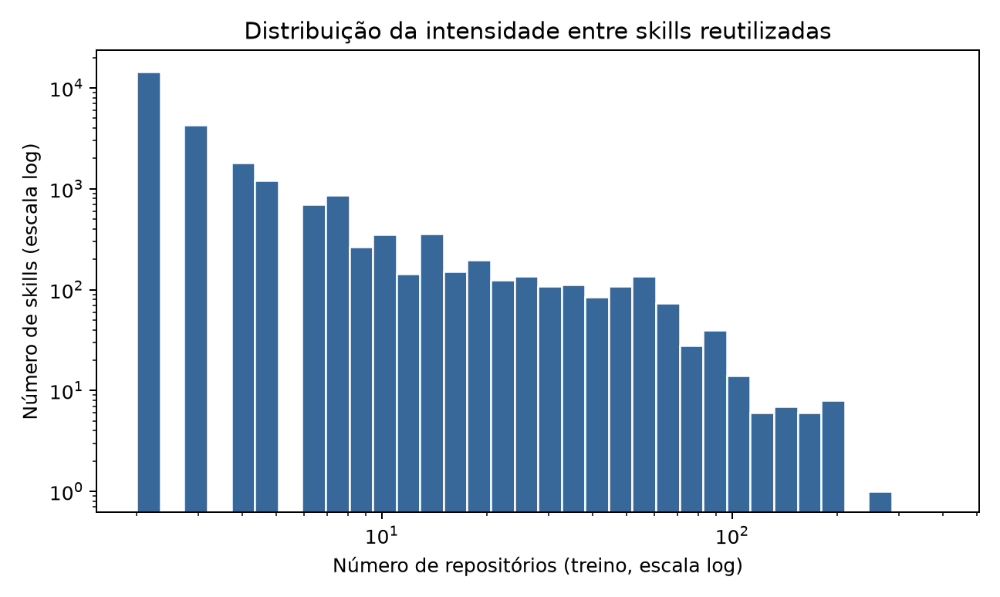
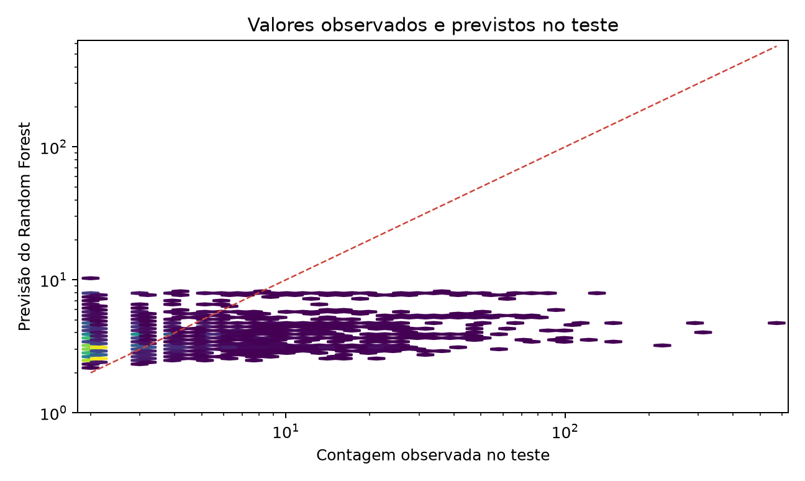
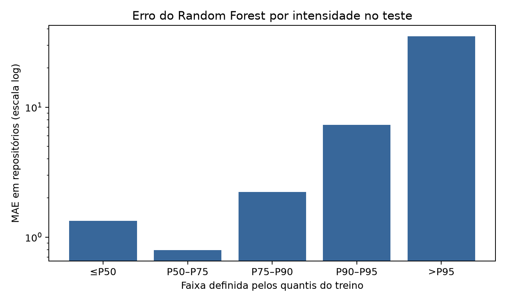
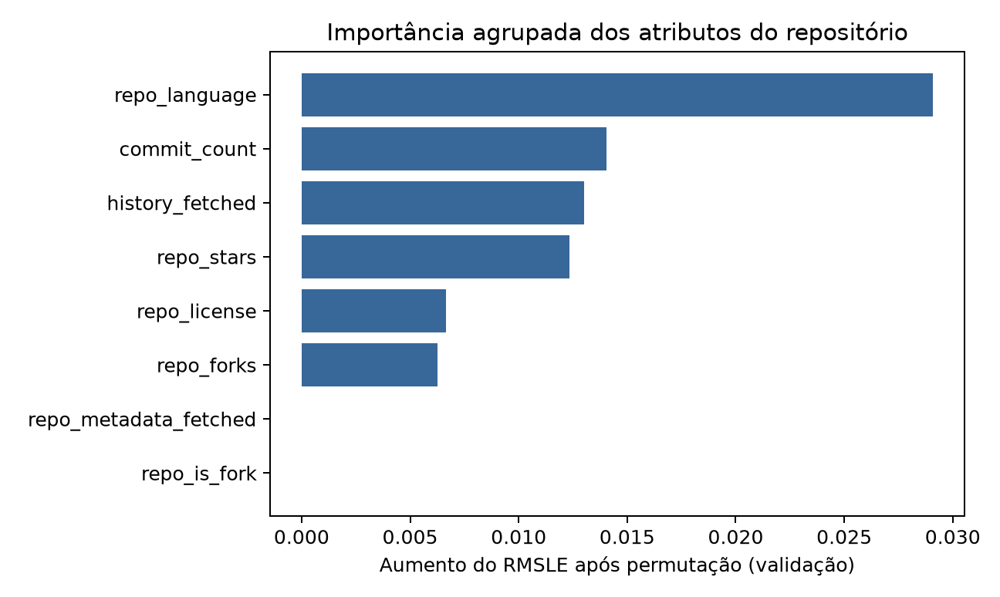
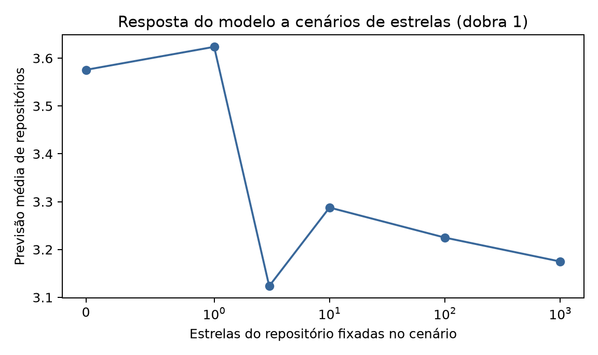

# 4. Resultados

## 4.1 Caracterização do alvo e dos dados

Esta seção apresenta os resultados consolidados do estudo para a disciplina. O benchmark comparativo foi realizado por validação cruzada agrupada e a avaliação externa foi executada uma vez após o congelamento dos candidatos na visão `repository-only`. Os resultados das visões textuais são apresentados em análises separadas.

Entre as skills reutilizadas, `repository_count` apresenta distribuição fortemente assimétrica e sobredispersa. A média é 5,075 repositórios, a mediana é 2, a variância é 112,22 e a razão entre variância e média é 22,11. O maior valor observado no conjunto de desenvolvimento é 390 repositórios. A diferença entre média e mediana indica que poucas skills concentram valores muito elevados.

Os quantis do desenvolvimento, calculados somente nas 25.918 skills reutilizadas, são:

| Quantil | P50 | P75 | P90 | P95 | P99 |
|---|---:|---:|---:|---:|---:|
| Repositórios | 2 | 4 | 8 | 16 | 55 |

: Quantis de `repository_count` entre as skills reutilizadas do desenvolvimento.

A figura abaixo mostra a concentração nos valores baixos e a cauda longa. No teste, o maior valor observado é 573. A transformação `log1p` estabiliza o ajuste, mas o resultado agregado deve ser lido junto com o erro na cauda.

Nos atributos de repositório do desenvolvimento, `commit_count` está ausente em 69,86% das 25.918 observações; estrelas, forks, linguagem, licença e estado de fork têm aproximadamente 0,035% de ausência cada. `history_fetched` e `repo_metadata_fetched` não têm valores ausentes, mas sinalizam a cobertura da coleta. A imputação e os indicadores de ausência foram ajustados dentro de cada dobra. A tabela auditável está em [`repository_missingness.csv`](../../reports/modeling/discipline_benchmark/report_audit/repository_missingness.csv).

## 4.2 Comparação das representações

A confirmação completa da configuração textual atual foi realizada com 10.000 candidatos TF-IDF e 500 termos selecionados, utilizando regressão Ridge sobre `log1p(repository_count)` e três dobras agrupadas. A representação híbrida apresentou o menor RMSLE entre as três visões avaliadas, embora a diferença para *skill-only* seja pequena.

| Representação com Ridge | RMSLE médio ± DP | MAE médio | Spearman médio |
|---|---:|---:|---:|
| `hybrid` | **0,568 ± 0,028** | 3,320 | 0,245 |
| `skill-only` | 0,572 ± 0,031 | 3,325 | 0,213 |
| `repository-only` | 0,588 ± 0,006 | 3,341 | 0,259 |

: Comparação das três representações com Ridge em três dobras agrupadas do desenvolvimento.

Os resultados sugerem sinal nos atributos textuais e estruturais da skill. A diferença média entre `hybrid` e `skill-only` é de apenas 0,004 no RMSLE, menor que a variação entre dobras; não se pode afirmar uma superioridade robusta do híbrido. `repository-only` apresenta a maior correlação de Spearman nessa comparação, apesar do pior RMSLE. Essas são estimativas de validação interna do Ridge; nenhum dos dois modelos textuais foi avaliado no teste externo.

Essa diferença também reforça a necessidade de interpretar o modelo híbrido com cautela. Parte do sinal pode estar associada ao contexto do repositório, e não a propriedades intrínsecas da skill. Assim, a vantagem híbrida não deve ser descrita como evidência de que o conteúdo da skill, isoladamente, determina maior reutilização.

## 4.3 Comparação das famílias de modelos

Como parte do trabalho da disciplina, foi executado um benchmark completo com 25.918 observações, três dobras agrupadas e a representação `repository-only`. Essa execução permite comparar todos os regressores sobre a mesma matriz de atributos, sem o gargalo da vetorização textual. Os resultados foram:

| Modelo `repository-only` | RMSLE médio ± DP | MAE médio ± DP | Spearman médio |
|---|---:|---:|---:|
| Random Forest | **0,575 ± 0,008** | 3,282 ± 0,120 | 0,287 |
| HistGradientBoosting | 0,583 ± 0,019 | 3,312 ± 0,034 | 0,255 |
| Gradient Boosting | 0,587 ± 0,010 | **3,173 ± 0,129** | **0,317** |
| Ridge | 0,588 ± 0,006 | 3,341 ± 0,156 | 0,259 |
| Decision Tree | 0,593 ± 0,017 | 3,321 ± 0,073 | 0,282 |
| KNN | 0,610 ± 0,027 | 3,452 ± 0,054 | 0,214 |

: Comparação dos seis regressores com atributos de repositório em três dobras agrupadas.

O Random Forest apresentou o menor RMSLE, enquanto o Gradient Boosting obteve o menor MAE e a maior correlação de Spearman. Isso mostra que a escolha do melhor modelo depende do critério: o primeiro favorece erro relativo na escala logarítmica, enquanto o segundo produz melhor erro absoluto e ordenação. O resultado também confirma que a árvore isolada e o KNN não oferecem vantagem consistente nessa representação.

Um spot-check agrupado comparou variantes dos dois candidatos. O Random Forest com `max_depth=12`, 100 árvores e `min_samples_leaf=3` teve RMSLE de **0,575 ± 0,008**, contra 0,576 ± 0,008 com 200 árvores e 0,578 ± 0,004 com profundidade 8. O Gradient Boosting com 200 estimadores e taxa 0,05 obteve **0,584 ± 0,008**, ante 0,587 ± 0,010 com 100 estimadores. O critério de escolha principal foi o RMSLE médio da validação agrupada.

O benchmark completo confirma que modelos ensemble não lineares capturam relações úteis na visão `repository-only`, mas não há um vencedor absoluto em todas as métricas. O desempenho de modelos mais flexíveis deve ser interpretado junto com o risco de memorizar padrões contextuais.

Após o congelamento da comparação da disciplina, os dois candidatos selecionados foram treinados em todas as 25.918 observações de desenvolvimento e avaliados uma única vez nas 6.479 skills reutilizadas do teste externo. A sobreposição de `representative_repo_id` foi zero.

| Modelo | RMSLE | MAE | MAE log1p | Spearman |
|---|---:|---:|---:|---:|
| Random Forest | **0,5833** | 3,2663 | 0,4063 | **0,3667** |
| Gradient Boosting | 0,5907 | **3,1820** | **0,3903** | 0,2315 |

: Avaliação externa dos dois candidatos congelados após a validação agrupada.

O Random Forest já era o candidato principal pelo RMSLE da validação. Os resultados externos estimam o desempenho dos dois candidatos na partição reservada; o teste não redefiniu a escolha. Em comparação com a referência constante que prediz a mediana do desenvolvimento (2 repositórios), o Random Forest reduz o RMSLE de **0,7142** para **0,5833**, mas aumenta o MAE de **3,0665** para **3,2663** e o MAE log1p de 0,3593 para 0,4063. A referência é forte nas métricas médias porque a maior parte do teste tem contagem baixa; o modelo melhora a diferenciação das contagens em RMSLE e Spearman, mas não domina todos os critérios.

## 4.4 Análise de erros por intensidade de reutilização

Para o Random Forest `repository-only`, as faixas foram definidas pelos quantis do desenvolvimento antes da auditoria das previsões externas salvas. O erro cresce rapidamente acima de oito repositórios:

| Faixa observada no teste | n | RMSLE | MAE | Erro mediano (previsto − real) | Subestimação |
|---|---:|---:|---:|---:|---:|
| ≤2 (P50) | 3.648 | 0,395 | 1,33 | +1,12 | 0% |
| 3–4 (P50–P75) | 1.522 | 0,224 | 0,79 | +0,14 | 41,3% |
| 5–8 (P75–P90) | 683 | 0,428 | 2,22 | −2,11 | 90,2% |
| 9–16 (P90–P95) | 302 | 0,925 | 7,29 | −7,02 | 100% |
| >16 (>P95) | 324 | 1,904 | 35,15 | −22,73 | 100% |

: Erros do Random Forest por faixas definidas pelos quantis do desenvolvimento e medidas no teste externo.

Acima do P95, a mediana observada é 27,5 e a mediana prevista é 4,45. Em todo o teste, a maior previsão foi 10,29, frente à maior contagem observada de 573. As figuras mostram a compressão das previsões e o aumento do erro absoluto na cauda.

Como análise separada, a auditoria por quantis do Ridge híbrido na validação encontrou subestimação crescente. Seus limiares foram calculados no treino de cada dobra e aplicados à validação; não se trata do teste do Random Forest.

| Faixa do alvo | Observações | RMSLE | MAE | Subestimação |
|---|---:|---:|---:|---:|
| Até P50 | 14.593 | 0,432 | 1,46 | 6,7% |
| P50–P75 | 6.087 | 0,302 | 1,11 | 48,3% |
| P75–P90 | 2.773 | 0,466 | 2,25 | 89,7% |
| P90–P95 | 1.232 | 0,890 | 7,20 | 99,7% |
| Acima de P95 | 1.233 | 1,692 | 34,75 | 100,0% |

: Auditoria separada do Ridge híbrido por quantis definidos no treino de cada dobra de validação.

O modelo apresenta desempenho relativamente bom para a região central, mas subestima de forma crescente os valores mais altos. Para as observações acima do P95, a mediana do alvo é 33 repositórios, enquanto a mediana da previsão é aproximadamente 6,22. Portanto, o RMSLE global de 0,568 oculta uma falha importante para o subgrupo mais reutilizado.

Essa auditoria confirma que o Ridge híbrido também não representa adequadamente a disseminação extrema. Os dois resultados de cauda pertencem a modelos, representações e conjuntos de avaliação diferentes e não são uma comparação direta.

## 4.5 Robustez textual

Foi comparado o texto bruto com uma versão que remove datas, números, URLs e identificadores longos. A remoção desses artefatos alterou pouco o desempenho: no modelo híbrido, o RMSLE passou de 0,568 para 0,570; no modelo `skill-only`, passou de 0,572 para 0,575.

Essa pequena diferença sugere que os artefatos textuais identificados não explicam sozinhos o sinal preditivo global. Entretanto, a análise não permite concluir que todos os termos sejam semanticamente relevantes. A representação textual ainda pode capturar convenções editoriais, templates e padrões de distribuição associados às skills reutilizadas.

## 4.6 Explicabilidade e consistência

A análise global inicial do modelo híbrido encontrou sete dos 500 termos selecionados com aparência de datas ou números; não foram identificados URLs ou identificadores longos entre os principais termos. Alguns termos recorrentes estavam relacionados a fragmentos editoriais, como `date_added` e `source community`, além de palavras de conteúdo geral.

A auditoria de estabilidade em três dobras encontrou recorrência de termos editoriais e de convenções de documentação. A versão com artefatos mascarados reduziu os sinais explicitamente numéricos, mas não eliminou termos associados a padrões editoriais. Esses achados devem ser tratados como associações descritivas: a presença de um termo pode indicar um template, uma origem comum ou um processo de publicação, e não necessariamente uma propriedade que cause reutilização.

Na importância por impureza do Random Forest ajustado em todo o desenvolvimento, os maiores valores pertencem a `repo_stars` (0,170), `history_fetched` (0,153), indicador de ausência de `commit_count` (0,132) e `repo_forks` (0,129). Essa medida pode favorecer atributos com mais valores ou categorias. A permutação dos oito atributos brutos na validação agrupada do desenvolvimento fornece um contraste: aumento médio de RMSLE de 0,029 ± 0,013 para `repo_language`, 0,014 ± 0,006 para `commit_count`, 0,013 ± 0,003 para `history_fetched` e 0,012 ± 0,012 para `repo_stars`. Uma das três dobras deu aumento de apenas 0,0005 para estrelas, indicando instabilidade desse sinal. Foi feita uma permutação por atributo e dobra, portanto a incerteza dessa estimativa é limitada.

Um cenário descritivo na primeira dobra variou `repo_stars` para 0, 1, 3, 10, 100 e 1.000 em 1.000 observações de validação, mantendo as outras entradas: a previsão média resultante foi 3,58; 3,62; 3,12; 3,29; 3,22; 3,17 repositórios. A resposta não é monotônica e alguns cenários podem combinar valores incomuns de estrelas e forks. Logo, o experimento não sustenta a afirmação de que aumentar estrelas causaria mais reutilização. Toda essa explicação descreve o contexto do repositório, não propriedades intrínsecas da skill.

## 4.7 Síntese dos resultados e estado da avaliação

Os resultados da disciplina sustentam quatro conclusões. Primeiro, existe sinal preditivo mensurável para a intensidade de reutilização, sobretudo na região central da distribuição. Segundo, a representação híbrida apresenta pequena vantagem global no Ridge, mas a comparação completa dos modelos foi realizada de forma controlada na visão `repository-only`. Terceiro, a cauda de alta reutilização continua sendo um problema relevante, com subestimação sistemática dos maiores valores. Quarto, as explicações identificam padrões textuais e contextuais plausíveis, mas não fornecem evidência de causalidade ou de qualidade intrínseca das skills.

O Random Forest foi escolhido na validação pelo menor RMSLE médio e obteve 0,5833 no teste externo. O Gradient Boosting apresentou MAE externo menor (3,1820). Ambos os resultados são descritivos para a divisão congelada. A referência constante superar o Random Forest em MAE e a subestimação integral acima do P95 impedem uma conclusão de bom desempenho geral. A análise de atributos da skill permanece parcial, pois a comparação com texto foi interna e restrita ao Ridge.
