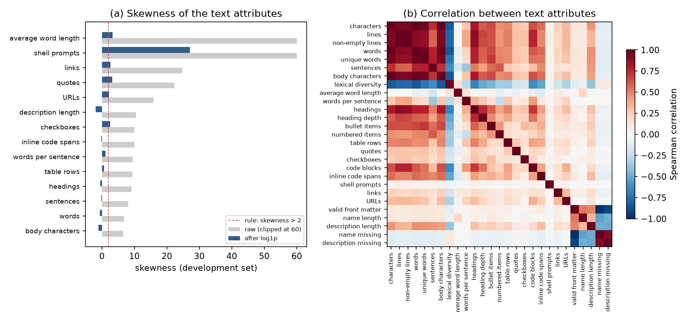
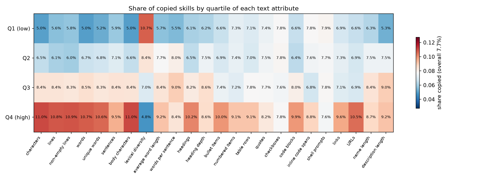
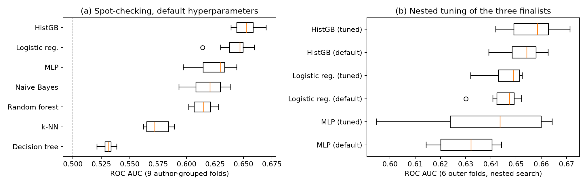
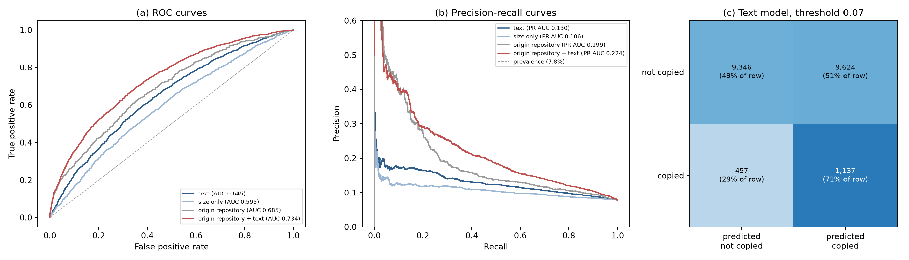
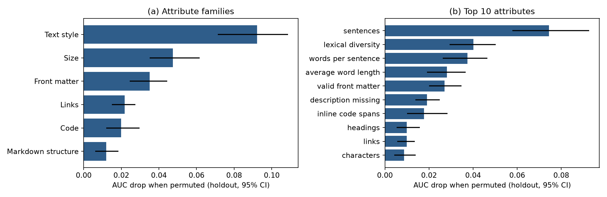

# 4. Results

We present the results in five stages: exploratory analysis (Section 4.1), model selection (Section 4.2), predictive performance (Section 4.3, RQ1), robustness analyses (Section 4.4), and model interpretation (Section 4.5, RQ2).

## 4.1 Exploratory analysis

**The data.** We established dated 198,579 of the 223,261 copies outside aggregators (88.9%). Most of the others were in repositories deleted or made private after July 2026 (Figure 1c).
Overall, 135,670 of the 150,000 skills had at least one dated copy.
After limiting each author to 50 skills, 135,332 remained: 94,683 in the development set (42,872 authors) and 40,649 in the holdout (18,373 authors).

**The target.**
Skills are typically copied soon after their first appearance.
Among development skills observed for at least 90 days, the first copy by another developer arrived after a median of 10.5 days, and a quarter arrived within 2.6 days (Figure 1a). A 30-day window would capture 73.5% of these first copies and a 60-day window 89.7%, so the rule of Section 3.2 set **W = 60 days**. The ecosystem is also young: almost all skills appeared after October 2025, when the format was introduced, and more new skills appeared every month (Figure 1b). With W = 60, only skills that appeared until 10 May 2026 are eligible: **48,299 in the development set and 20,564 in the holdout**. Copied skills are a minority: **7.7%** of the eligible skills were copied by another developer within the window.

**The attributes.** All 27 text attributes are numbers; three of them (a valid front matter, a missing name, a missing description) are yes-or-no. They have no missing values, and the origin attributes almost none (0.02%, in language and license). The real problem is their distribution (Figure 2a). Most counts are zero for many skills and very large for a few — the typical skill has no links and no inline code, while some have thousands — and 21 of the text columns have skewness above 2. The extreme case is the average word length (skewness 218), caused by a few files that are not prose at all, such as long encoded strings. We kept them, since they are real skills, and the log transform reduces their weight. We found no impossible values. The only inconsistency, 684 copies dated after the snapshot, had already been handled during the collection. Two origin attributes were constant and were removed: the fork flag and the stars at T0, which the API could not provide (Section 3.3).

Many attributes measure almost the same thing (Figure 2b). Characters, words, unique words and body length are nearly interchangeable measures of size, and lexical diversity falls as all of them grow, because longer texts repeat more words. Eight pairs exceed a Spearman correlation of 0.95. Removing five columns (words, unique words, body length, non-empty lines, and a missing name, which duplicates an invalid front matter) leaves 22 attributes for the scale-sensitive models. The front-matter attributes, in contrast, are almost unrelated to size and style, so they bring a different kind of information.

**First signs of a signal.** Simple tables already suggest that the text matters (Figure 3). The share of copied skills more than doubles from the shortest to the longest texts (from 5.0% to 11.0% across quartiles of characters), falls from 10.7% to 4.8% as lexical diversity grows, and rises with the number of sentences, headings, links and code blocks. Skills with an invalid front matter are copied far less often than those with a valid one (2.8% against 8.3%). But these tables look at one attribute at a time, and the attributes move together: a longer text also has more sentences, more headings and more code. To tell which characteristics carry information of their own, we need a model.

## 4.2 Choosing a model

Table 4 and Figure 4 summarize how the model was chosen. In the spot-check, HistGradientBoosting (AUC 0.652) and logistic regression (0.642) came first, followed by the neural network, Naive Bayes and the random forest. k-nearest neighbors and the decision tree came last, and both suffered from their default settings. By default, k-nearest neighbors looks at only five neighbors, and each prediction is the share of them that were copied. Because few skills are copied, many predictions are zero and the others take only five other values, so many skills tie and the ranking is coarse. The default decision tree has no depth limit and accepts leaves with a single skill, so it keeps splitting until each leaf holds a single class: it memorizes the training data and does not generalize. The results varied little from fold to fold (standard deviations of 0.005 to 0.015), so the ranking of the default settings is clear.

| Algorithm | Spot-check AUC | Nested, default | Nested, tuned |
|---|---:|---:|---:|
| HistGradientBoosting | 0.652 ± 0.011 | 0.653 | 0.657 |
| **Logistic regression** | **0.642 ± 0.014** | **0.645** | 0.646 |
| MLP | 0.625 ± 0.015 | 0.630 | 0.638 |
| Naive Bayes | 0.619 ± 0.014 | | |
| Random Forest | 0.614 ± 0.009 | | |
| k-NN | 0.574 ± 0.010 | | |
| Decision tree | 0.531 ± 0.005 | | |

: Model selection on the text attributes: spot-check (mean ± standard deviation over 9 folds) and nested tuning of the three best algorithms (mean over 6 outer folds). The selected configuration is in bold.

Tuning improved every algorithm a little, and tuned HistGradientBoosting came first (AUC 0.657). Its lead, however, is within the noise. It is 0.012 above the default logistic regression (95% CI [−0.004; 0.028]) and 0.004 above its own default version, and none of its comparisons with the other five configurations is significant after Holm's adjustment (all adjusted p ≥ 0.19). Following the rule fixed in advance, we chose the fastest of the tied configurations: **logistic regression with default hyperparameters** (AUC 0.645), which trains in a fraction of a second. We give up about 0.01 AUC and gain a model whose behavior can be read directly. The result is informative in itself: if a linear model does as well as boosted trees, the signal does not depend on complex interactions between attributes.

**Decision threshold.** Metrics such as precision and recall need a threshold on the predicted probability. We chose it on the development set, before opening the holdout. Using the out-of-fold probabilities of the text model, we tried every value from 0.01 to 0.99 and kept the one that maximizes balanced accuracy: the mean of the share of copied skills that are flagged and the share of non-copied skills that are not, so that both classes weigh the same although copied skills are rare. This gives 0.07 (balanced accuracy 0.603, precision 10.5%, recall 71.6%). Because the probabilities stay close to the average (7.7%), it flags about half of the skills (52%).

## 4.3 Does the text predict whether a skill is copied? (RQ1)

The decisive test is the holdout, used once (Table 5 and Figure 5). On 20,564 skills from 10,386 authors it had never seen, the text model reached an **AUC of 0.645** (95% CI [0.624; 0.666]). In plain terms: given one skill that other developers copied and one they did not, the model gives the copied one a higher score about 65% of the time. The interval lies well above 0.5, so the answer to RQ1 is yes: the text of a skill carries information about whether other developers will copy it (Holm-adjusted p = 0.002, the smallest value that 2,000 bootstrap samples can give). The holdout result is close to the development one (0.642 ± 0.014), so the model did not overfit.

| Model | Development AUC | Holdout AUC [95% CI] | PR AUC |
|--------------------------------|---------------------:|---------------------------------:|-----------:|
| **Text** | 0.642 ± 0.014 | **0.645** [0.624; 0.666] | 0.130 |
| Size only (reference) | 0.596 ± 0.018 | 0.595 [0.573; 0.615] | 0.106 |
| Origin repository | 0.676 ± 0.016 | 0.685 [0.664; 0.704] | 0.199 |
| Origin repository + text | 0.725 ± 0.012 | 0.734 [0.714; 0.753] | 0.224 |

: Final models (logistic regression) on the development set (mean ± standard deviation over 9 author-grouped folds) and on the holdout (20,564 skills from 10,386 authors; 7.8% copied; 95% CIs from author bootstrap).

Two comparisons show what kind of information the text carries. **It is more than length.** A model that sees only the size of the text reached 0.595; the full text model is **0.050** higher (95% CI [0.033; 0.069]). **It is not just a sign of where the skill was published.** A model of the origin repository — its age, language, license, the folder of the file and its popularity — reached 0.685, and adding the text raised it to 0.734, a gain of **0.049** (95% CI [0.035; 0.063]; Holm-adjusted p = 0.002). Recall that the repository's popularity was measured after T0, which favors the repository; the text adds information even so. The precision–recall curves agree (Figure 5b): every model is above the line of a random guess, and from a recall of about 0.13 on, the text improves the origin model at every level.

What the model offers is a ranking, not a reliable yes-or-no answer. Its PR AUC (0.130) is 1.7 times the share of copied skills. At the threshold chosen on the development set (a probability of 0.07), it flags 10,761 holdout skills as likely to be copied. Among them are 1,137 of the 1,594 skills that were copied (recall 71%), but most flagged skills were not copied (precision 10.6%; balanced accuracy 0.603; Figure 5c). Its probabilities also stay close to the average (Brier score 0.0701, against 0.0715 for predicting 7.8% for every skill): the model separates skills, but it never finds one that is very likely to be copied. In practice, it can help decide which skills to look at first, not decide on its own.

## 4.4 How robust is the result?

The answer to RQ1 rests on several choices of ours: the window, the definition of aggregator, and a split by author that mixes old and new skills. Table 6 shows the text model when each of them changes. None changes the conclusion.

| Analysis | Skills | Copied | AUC [95% CI] |
|----------------------------------------------|---------:|-------:|---------------------:|
| Main analysis (W = 60, aggregators ≥ 100) | 20,564 | 7.8% | 0.645 [0.624; 0.666] |
| Window W = 30 days | 28,464 | 5.7% | 0.648 [0.628; 0.666] |
| Window W = 90 days | 13,460 | 9.4% | 0.633 [0.612; 0.656] |
| Aggregators: limit of 500 skills | 20,648 | 9.0% | 0.644 [0.624; 0.663] |
| Aggregators: no exclusion | 20,694 | 12.5% | 0.653 [0.635; 0.671] |
| Temporal split (T0 after 14 April 2026) | 6,031 | 6.7% | 0.634 [0.589; 0.681] |

: Text model under the robustness analyses (holdout; CIs from 500 author-bootstrap samples, 2,000 for the main analysis). Each analysis retrains the model on the development set with the selected configuration.

**The window.** With 30 or 90 days, the share of copied skills ranges from 5.7% to 9.4%, but the AUC stays within 0.012 of the main result. **The aggregators.** Counting copies in repositories with 100 to 499 skills, or in all repositories, raises the share of copied skills from 7.8% to 9.0% and 12.5%: bulk collectors would inflate the number of copied skills by more than half. The AUC, however, stays at 0.644 and 0.653. **Time.** The hardest test is the temporal split. Trained only on skills that appeared before 14 April 2026, the model ranked the 6,031 holdout skills that appeared afterwards with an AUC of 0.634: the text predicts the fate of skills that did not yet exist when the model learned. In all five alternative analyses the AUC stays between 0.633 and 0.653, and every interval lies above 0.5. The answer to RQ1 does not depend on these choices.

## 4.5 What the model learned (RQ2)

Having established that the text predicts copying, we now ask which characteristics of the text the model relies on, and in which direction they act.

**Which characteristics.** Writing style is the most important family by far (Figure 6a). Shuffling it lowers the AUC by 0.092 (95% CI [0.071; 0.109]), about twice as much as size (0.047), and more than front matter (0.035), links (0.022), code (0.020) and Markdown structure (0.012). This ranking is stable: style comes first in all nine development folds, and the order of the six families in each fold agrees with the order on the holdout (Spearman correlation 0.71 to 1.00). Among single attributes, the number of sentences matters most (0.074), followed by lexical diversity, words per sentence, average word length and a valid front matter (Figure 6b); the SHAP values agree on four of these five, with inline code spans in place of average word length. Note that the whole size family matters less than the number of sentences alone. The reason is that its correlated attributes act in opposite directions in the model, so shuffling them together partly cancels out.

**In which direction.** Figure 7 shows how each attribute moves the predictions. Skills with **more sentences**, **more words per sentence**, **longer words** and a **valid front matter** are pushed toward being copied; skills with a **more varied vocabulary** or a **missing description** are pushed away (Figure 7a). The dependence plots show the shape of the main effects (Figure 7b). More sentences help a lot among short texts, and the gain levels off beyond about 50 sentences. The effect of lexical diversity is linear over its whole range. An invalid front matter lowers the log-odds by about 0.9 compared with a valid one. For the number of sentences, lexical diversity and the front matter, these directions agree with the simple tables of Section 4.1.

**Unexpected relations.** For four attributes, the direction flips between the simple tables and the model. On their own, longer texts, longer descriptions, more headings and more inline code go with *more* copying (Figure 3); in the model, they push predictions *down* (Figure 7a). Both views are correct, because they answer different questions. A table compares skills that differ in everything at once: longer texts also have more sentences. The model compares skills with the same amount of prose. Among those, a skill with more characters, more headings and more inline code is a denser, more technical text, and such texts are copied less. The same holds for the description: having one matters a great deal, but a longer one does not help once everything else is taken into account.

Taken together, these effects draw a clear picture. The skills that other developers copy read like explanations: several full sentences, a vocabulary that repeats rather than varies, longer words, and a valid front matter that tells the agent what the skill is for. The skills rarely copied are either short and terse, or packed with structure and code compared with their prose — closer to notes written for one project than to instructions written for others.
