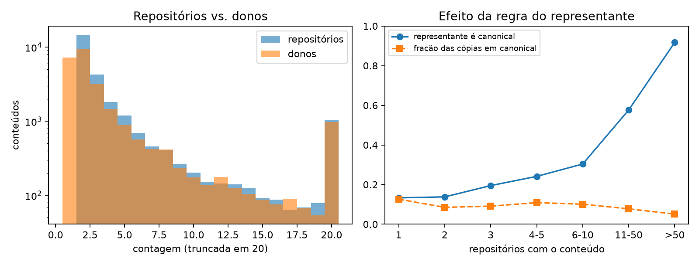
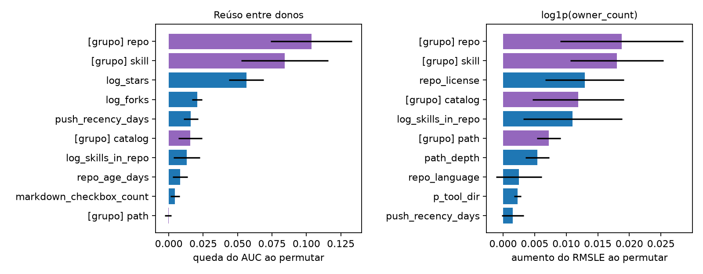
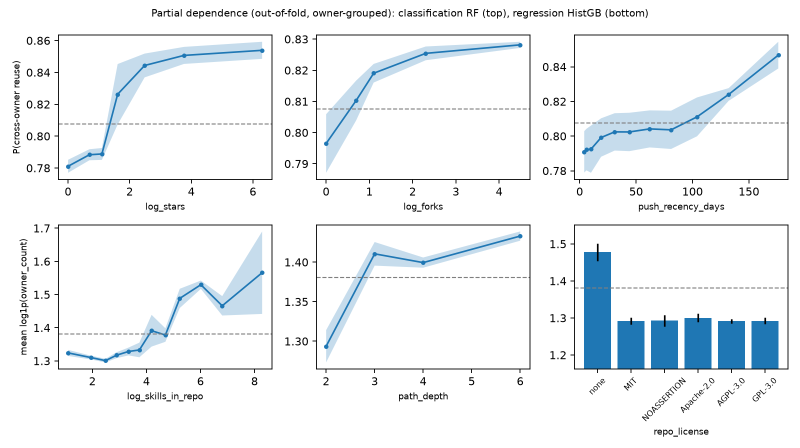
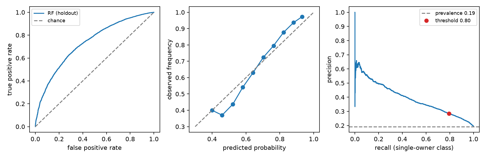

# 4. Results

## 4.1 The target, the features and owner concentration

In development (25,918 reused contents from 7,128 owners), the number of owners has a distribution similar to that of repositories: strong positive skew and overdispersion.

| | mean | P50 | P75 | P90 | P95 | P99 | max | variance/mean |
|---|---:|---:|---:|---:|---:|---:|---:|---:|
| `repository_count` | 5.08 | 2 | 4 | 8 | 16 | 55 | 390 | 22.1 |
| `owner_count` | 4.50 | 2 | 3 | 8 | 15 | 53 | 379 | 23.1 |

: Distribution of the count targets in development.

The difference lies at the base of the distribution: **28.0%** of reused contents have `owner_count = 1`, i.e., all copies are under a single owner. Self-copying accounts for 11% of the total mass of `repository_count`. A few owners concentrate the sample: the five largest account for 11.9%, 4.7%, 3.5%, 2.2% and 2.2% of the contents (24.5% together; identifiers omitted). The largest and the fourth are clear cases of self-copying: their contents have on average 2.0 repositories but only 1.0 owner. In addition, 17.2% of the contents have no `name` in the front matter, and 20.1% (24.3% of those that have a `name`) share the `name` with another content, a sign of variants of the same skill.

**Features.** The clean view has 52 columns (49 numeric, 3 categorical) that expand to 112 columns after preprocessing. Missing values are rare: 13 columns have any, at most 0.2% (folder information 0.2%, repository metadata 0.05%), imputed by the training median with an indicator. One column is constant (`repo_is_fork`) and was kept, as it is harmless. Twenty-five numeric columns have skewness above 2 (for example `sibling_count` 116, `sibling_bytes` 63, `markdown_url_count` 32, reduced to 1.6, 0.5 and 1.7 by `log1p`); because trees are invariant to monotone transformations, we apply `log1p` only in a sensitivity analysis for linear models (Section 4.4). Eight pairs of numeric columns have |ρ| > 0.95 (for example `body_chars` and `text_char_count`, 0.998); we kept them, since trees tolerate redundancy, and read the permutation importance of redundant columns with caution (Section 4.5). No dimensionality reduction was applied. Finally, `cross_owner` is positive for 80.4% of the development contents (80.8% in the holdout); we do not resample and rely on threshold-free metrics.

## 4.2 Selection bias of the representative

The following table compares, on the full population (1,877,981 contents), the fraction of contents whose representative is `canonical` with the fraction of copies that are actually `canonical`.

| Repositories | contents | representative is `canonical` | copies in `canonical` |
|---|---:|---:|---:|
| 1 | 1,571,893 | 13.3% | 12.6% |
| 2 | 172,624 | 13.8% | 8.5% |
| 3 | 49,535 | 19.5% | 9.1% |
| 4–5 | 36,312 | 24.1% | 10.9% |
| 6–10 | 24,142 | 30.4% | 10.1% |
| 11–50 | 19,589 | 57.7% | 7.7% |
| more than 50 | 3,886 | 91.7% | 5.1% |

: Effect of the representative rule, by number of repositories (full population).

The probability that the representative is `canonical` grows from 14% to 92% with the number of copies, while the actual share of copies in that folder is flat or decreasing (5–13%). This follows from the recovered rule (Section 3.3): a single copy in `.claude/skills/` is enough for the representative to be `canonical`. The location class of the representative, and the commit history that only exists for standard locations, **encode the number of copies**.

In the first version of the study, with `repository_count` as target and repository attributes, this inflated the result. With the Random Forest and the full development set, the repository attributes gave an RMSLE of 0.575; without `history_fetched` and `commit_count`, 0.604 (difference of +0.029, 95% CI [0.018; 0.040]), against 0.623 for the mean-of-`log1p` baseline. The location of the representative alone (three categories) gave 0.584, and the history alone 0.594. The "repository" view was, to a large extent, a proxy for location.

## 4.3 Main protocol

With the shortcuts out, 17,733 contents (cap of 50 per owner) and owner-grouped validation, the results of the Random Forest (RF) and of the linear models are:

| View | RF AUC | logistic AUC | RF RMSLE | Ridge RMSLE |
|---|---:|---:|---:|---:|
| skill | 0.660 ± 0.022 | 0.614 | 0.698 ± 0.007 | 0.713 |
| repository | 0.650 ± 0.019 | 0.655 | 0.707 ± 0.011 | 0.702 |
| repository + catalog | 0.666 ± 0.009 | 0.662 | 0.696 ± 0.010 | 0.699 |
| path + catalog | 0.579 ± 0.019 | 0.576 | 0.718 ± 0.018 | 0.714 |
| **clean (full)** | **0.716 ± 0.024** | 0.680 | **0.679 ± 0.011** | 0.694 |
| clean + shortcuts | 0.717 ± 0.022 | 0.682 | 0.637 ± 0.015 | 0.664 |
| shortcuts only | 0.500 ± 0.015 | 0.510 | 0.688 ± 0.010 | 0.693 |
| *baseline* | 0.500 | 0.500 | 0.720 (mean), 0.780 (median) | |

: Performance by view (mean ± standard deviation over 9 owner-grouped folds).

All pre-specified hypotheses are rejected after Holm correction:

| | Comparison | Result | 95% CI of the difference | p (Holm) |
|---|---|---|---|---:|
| H1 | clean RF AUC against 0.5 | 0.716 | +0.216 [0.173; 0.259] | < 0.001 |
| H2 | clean RF RMSLE against the mean | 0.679 vs 0.720 | −0.041 [−0.049; −0.033] | < 0.001 |
| H3a | clean against repository+catalog (AUC) | 0.716 vs 0.666 | +0.050 [0.017; 0.083] | 0.008 |
| H3b | clean against skill (AUC) | 0.716 vs 0.660 | +0.056 [0.040; 0.072] | < 0.001 |
| H4 | clean+shortcuts against clean (RMSLE) | 0.637 vs 0.679 | −0.042 [−0.055; −0.029] | < 0.001 |

: Pre-specified hypotheses on development (exploratory until the confirmation of Section 4.7).

There is a real but modest signal: an AUC of 0.72 and a 6% reduction in RMSLE. Skill and repository contribute **complementarily**: each block alone sits at AUC 0.65–0.67, and the combination at 0.72 (H3a and H3b). The shortcuts add to the regression (H4) but, alone, do not predict cross-owner reuse (AUC 0.50): the regression gain comes from their correlation with the number of copies, not from cross-owner reuse. The path, in isolation, barely predicts.

## 4.4 Robustness

**Per-owner cap.** The performance of the clean RF changes little in RMSLE, but a lot in AUC, depending on how concentrated owners are treated:

| Treatment | contents | clean RF AUC | RMSLE gain (clean) | gain (shortcuts only) |
|---|---:|---:|---:|---:|
| no limit | 25,918 | 0.747 ± 0.140 | 0.039 | 0.040 |
| exclude owners with more than 1000 | 21,615 | 0.615 ± 0.036 | 0.036 | 0.040 |
| exclude owners with more than 500 | 19,567 | 0.708 ± 0.037 | 0.030 | 0.041 |
| exclude owners with more than 200 | 18,443 | 0.732 ± 0.035 | 0.037 | 0.040 |
| **50 per owner** | 17,733 | 0.716 ± 0.024 | 0.041 | 0.031 |

: Sensitivity to the treatment of concentrated owners (RF, baseline = mean of `log1p`).

The RMSLE is stable (gain of 0.03–0.04), but the AUC oscillates from 0.615 to 0.747: a few owners with 500 to 1000 contents lower the AUC by 0.1, and with no limit a single fold concentrates one owner and the standard deviation reaches 0.14. Performance therefore depends on the composition of a dozen accounts. The cap of 50 stabilizes the estimates, but it is a data-dependent choice.

**Other checks.** (i) Fixing the location class and training within each one (owners with more than 500 contents excluded), the clean RF still beats the baseline: `canonical` (5,439 contents) RMSLE −0.141 and AUC 0.714; `skills-dir` (10,721) −0.013 and 0.672; `other` (3,810) −0.011 and 0.828. The signal is not only location. (ii) With `repository_count` as target, the gain of the clean RF is the same (−0.031 versus −0.030). (iii) Only 18.8% of validation rows have a `name` seen in training; on the subset without overlap the gain persists (RMSLE −0.039 versus −0.041 on all; AUC 0.726 versus 0.716), which indicates that variants of the same `name` do not explain the result. (iv) Repository-grouped validation, instead of owner-grouped, did not produce larger estimates (RMSLE 0.657 versus 0.655; AUC 0.735 versus 0.747, with the standard deviation of 0.14 of the no-limit case). (v) Applying `log1p` to the 25 skewed numeric columns improves the linear models only slightly (logistic AUC 0.680 → 0.691; Ridge RMSLE 0.694 → 0.690) and leaves the forests unchanged (0.716 → 0.714); the forest's advantage over the linear model remains statistically undistinguishable from zero (AUC +0.023, 95% CI [−0.012; 0.058]; RMSLE −0.012 [−0.024; 0.001]).

## 4.5 Interpretation

For cross-owner reuse, the repository block weighs more (AUC drop of 0.104 when permuted) than skill (0.084), catalog (0.016) and path (≈ 0). Among columns, `log_stars` dominates (0.056), followed by `log_forks` (0.021) and `push_recency_days` (0.016). In regression, repository (0.019) and skill (0.018) weigh similarly, and the largest column is the license (0.013), followed by catalog size (0.011) and path depth (0.005). Uncertainties are large (6 folds), and the correlation among attributes limits the individual reading.

The partial dependence shows the **direction** of these associations. The probability of cross-owner reuse rises with stars (0.78 with no stars to 0.85 at about 540, mostly between 1 and 12 stars and then flat) and with forks (0.80 to 0.83), and also with the **time since the last push**: repositories whose last push is older than about 100 days have higher predicted probability (0.79 at 4 days; 0.85 at 176 days). In regression, the expected number of owners rises with catalog size (a clear increase only for catalogs of roughly 60 or more skills) and with path depth (a jump from depth 2 to 3, then a plateau). The unexpected result is the license: what matters is not its type but its **absence**. Repositories without a license (52% of the development contents, median of zero stars) host skills with 6.6 owners on average, against 3.7 for MIT, and the model predicts 1.48 versus 1.29–1.30 for `log1p(owner_count)` for any license; unlicensed repositories also have more `canonical` skills (34% versus 24% for MIT). We do not know the mechanism: it may reflect repositories created automatically or by installers, which are copied across owners, and the data do not separate this from an effect of the missing license itself.

## 4.6 Model selection and tuning

| Family | AUC default | AUC searched | RMSLE default | RMSLE searched |
|---|---:|---:|---:|---:|
| linear | 0.678 | 0.689 | 0.692 | 0.690 |
| KNN | 0.667 | 0.690 | 0.703 | 0.686 |
| tree | 0.614 | 0.634 | 0.807 | 0.699 |
| Random Forest | **0.716** | 0.701 | 0.679 | 0.675 |
| Gradient Boosting | 0.691 | 0.704 | 0.690 | 0.671 |
| HistGradientBoosting | 0.693 | 0.682 | **0.670** | 0.688 |
| *baseline* | 0.500 | | 0.720 | |

: Nested validation (mean of 6 outer owner-grouped folds; 6 candidates per search).

By the pre-specified rule, we froze the default RF (classification) and the default HistGradientBoosting (regression). **The families tie:** the RF against the runner-up (searched Gradient Boosting) has an AUC difference of 0.012 (95% CI [−0.003; 0.026]), and in regression the HistGB against the searched Gradient Boosting has −0.001 [−0.027; 0.024]. Only the decision tree (and, with less evidence, the default KNN) falls behind, and in classification even these differences do not survive Holm correction (p between 0.06 and 0.13). The hyperparameter search did not beat the default configuration (RF classification: default 0.716 versus searched 0.701).

## 4.7 Confirmation on the holdout

The frozen models were evaluated once on 25,011 contents from 10,484 owners disjoint from development.

| Task | Model | Result | Baseline | 95% CI (owner bootstrap) |
|---|---|---:|---:|---|
| `cross_owner` | Random Forest | AUC **0.731**; PR AUC 0.913; Brier 0.140; log-loss 0.444 | 0.5; 0.808; 0.155; 0.490 | AUC [0.716; 0.745]; PR AUC [0.905; 0.921] |
| `log1p(owner_count)` | HistGradientBoosting | RMSLE **0.625**; Spearman 0.330 | 0.664 (mean of `log1p`) | difference −0.038 [−0.044; −0.032] |

: Single evaluation on the holdout.

The success criteria were met: the lower AUC bound is above 0.5 and the upper bound of the RMSLE difference is below zero. The holdout AUC (0.731) is consistent with the nested estimate on development (0.716). The holdout has a different composition (36% `canonical` skills versus 21% in development, and 9% `other` versus 21%), since concentrated owners are left out by construction. H3 and H4 were not re-evaluated on the holdout and remain exploratory.

**Minority class and threshold.** The PR AUC above refers to the majority class (80.8% prevalence), so it says little. For the minority class (content that exists under a single owner, 19.2% of the holdout), the PR AUC is 0.390 (95% CI [0.362; 0.418]), about twice its prevalence. The threshold that maximizes the balanced accuracy on development out-of-fold predictions is 0.80 (the default 0.5 gives a balanced accuracy of only 0.506 on development, because of the imbalance). Applied unchanged to the holdout, it gives a balanced accuracy of 0.659 (95% CI [0.647; 0.670]), against 0.663 on development, with a recall of 0.79 and a precision of 0.28 for the single-owner class (3,816 of 4,809 true single-owner contents recovered, but 9,607 cross-owner contents flagged as single-owner). The model therefore **orders** contents usefully, but a decision threshold produces many false alarms, and it should not be used for automated decisions.
