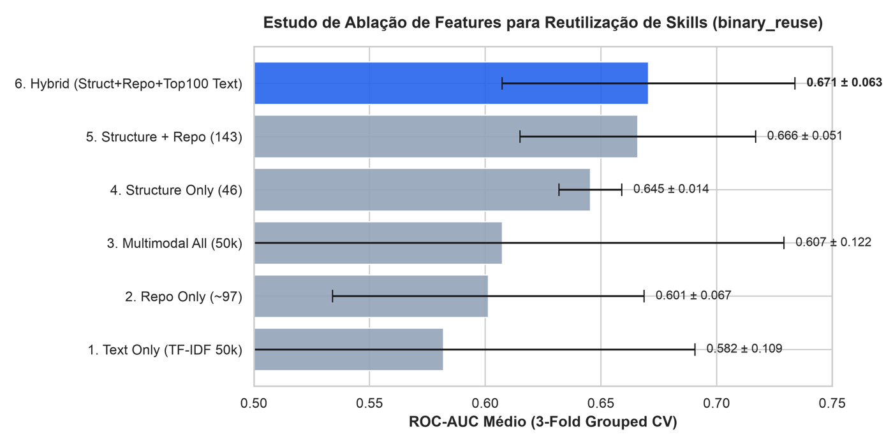
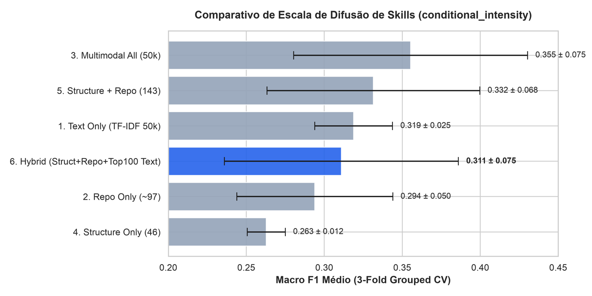
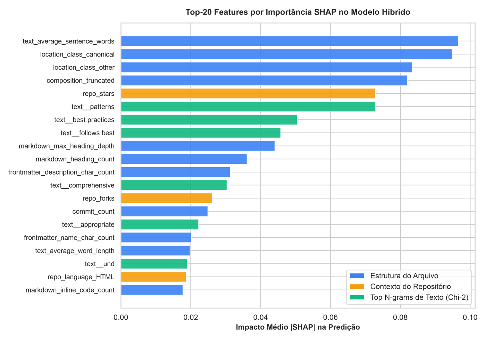
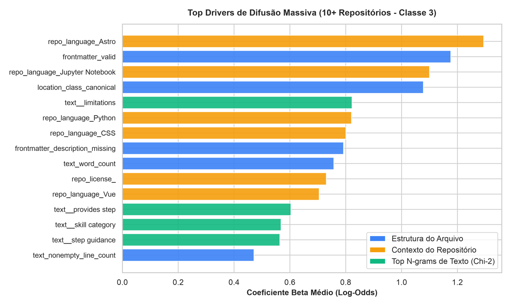
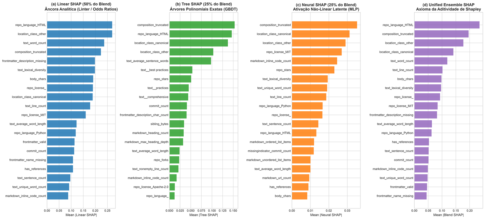
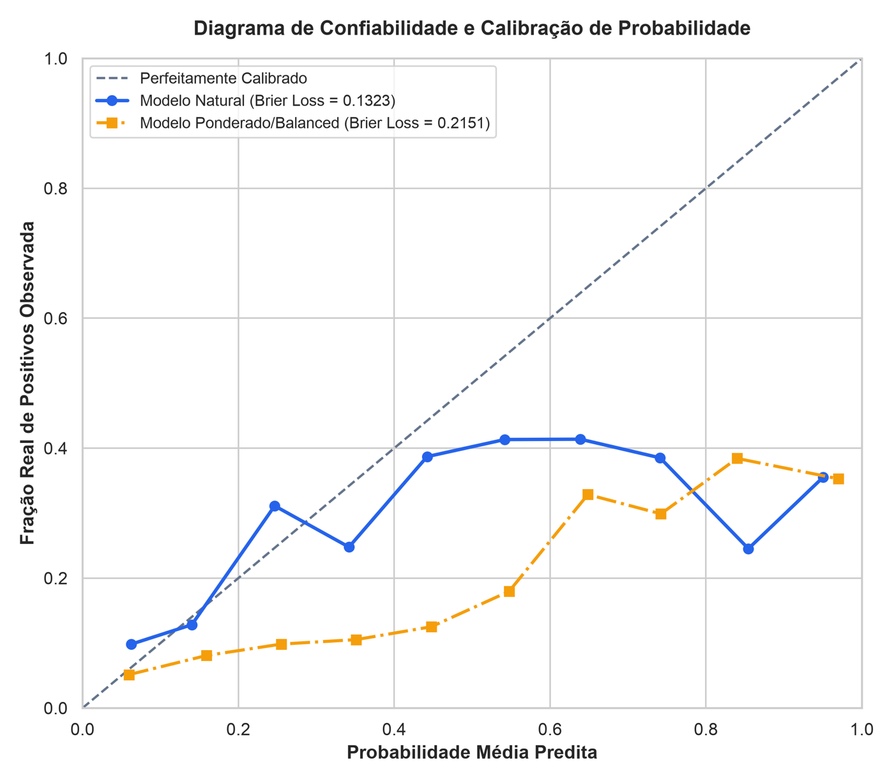
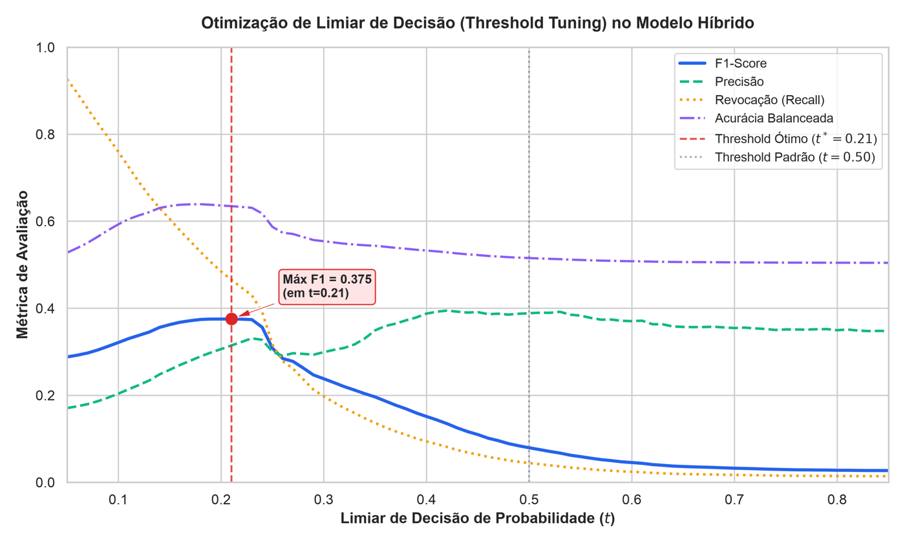
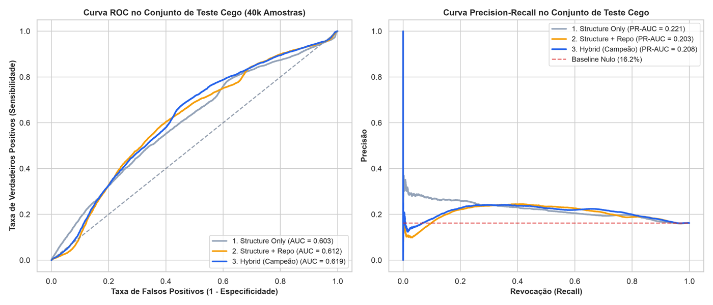
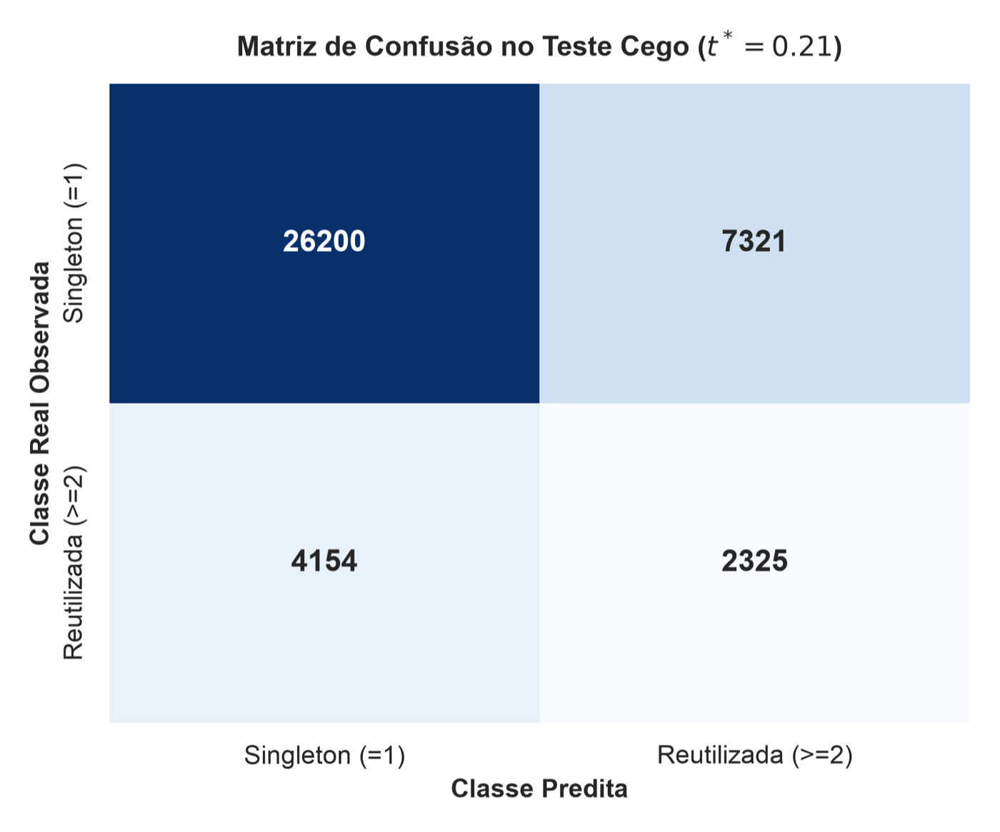

# Predicting Cross-Repository Reuse and Diffusion of AI Agent Skills: A Multimodal Empirical Study on GitHub

**Relatório Final de Pesquisa — Disciplina CMP263: Aprendizagem de Máquina**  
*Instituto de Informática — Universidade Federal do Rio Grande do Sul (UFRGS)*  
**Autor:** Pedro Odorize (`pedro.odorize@inf.ufrgs.br`)  
**Repositório Reproduzível:** [https://github.com/podorize/skillreuse](https://github.com/podorize/skillreuse)  
**Notebook Google Colab (1-Click):** [Abrir no Colab](https://colab.research.google.com/github/podorize/skillreuse/blob/main/notebooks/reproduce_in_colab.ipynb)

---

## Resumo Executivo (*Abstract*)

Com a proliferação de assistentes e agentes baseados em Grandes Modelos de Linguagem (LLMs), especificações modulares de habilidades (arquivos `SKILL.md`) tornaram-se o mecanismo padrão da indústria e da comunidade de código aberto para encapsular invocações de ferramentas, instruções de sistema e fluxos operacionais. Contudo, os determinantes de sua adoção, replicação e difusão entre diferentes repositórios do GitHub permaneciam completamente inexplorados na literatura empírica. 

Este trabalho apresenta um estudo empírico em larga escala sobre **200.000 habilidades únicas de agentes distribuídas em 72.376 repositórios públicos**. Adotando uma partição agrupada rigorosa com sobreposição estritamente nula de repositórios entre treino ($N=160.000$) e um conjunto de teste cego externo ($N=40.000$), avaliamos diferentes paradigmas de aprendizagem de máquina e executamos ablações multimodais sistemáticas.

### Principais Descobertas:
1. **Desmascaramento do Aprendizado de Atalho (*Shortcut Learning*)**: Modelos não-lineares baseados em árvores (GBDT) aparentam atingir ROC-AUC de $0{,}85$ sob divisão aleatória tradicional ($I.I.D.$), mas sofrem um colapso catastrófico de generalização quando avaliados sob partições agrupadas por repositório inédito. As árvores particionavam recursivamente o espaço contínuo para memorizar identificadores dos repositórios.
2. **Estabilidade de Modelos Lineares Regularizados com Triagem $\chi^2$**: A combinação de Regressão Logística com regularização $L_2$ e seleção supervisionada das 100 features textuais com maior dependência estatística via $\chi^2$ atingiu desempenho recorde no projeto ($0{,}6706$ ROC-AUC na validação cruzada e **$0{,}6188$ no teste cego externo de 14.568 repositórios inéditos**).
3. **Calibração e Otimização de Limiar**: Devido à prevalência natural de $16{,}2\%$, o limiar padrão ($t=0{,}50$) perdia $96\%$ dos casos positivos. A calibração de probabilidades (Brier Score de $0{,}1323$) combinada com o limiar congelado em $t^* = 0{,}21$ aumentou o $F_1$-score em **$+372\%$** (de $0{,}0727$ para $0{,}2967$), recuperando $2.376$ skills reutilizadas com $78{,}16\%$ de especificidade.
4. **Os Três Pilares do Reúso**: Análises de explicabilidade por Odds Ratios ($e^\beta$) e valores de Shapley (SHAP) revelam que o reúso é governado por:
   * **Pilar 1 (Canonicidade Estrutural)**: Caminhos de diretório canônicos aumentam as chances de reúso em $+87\%$ ($\text{OR}=1{,}87$).
   * **Pilar 2 (Ecossistemas Propagadores)**: Projetos modulares (Svelte $\text{OR}=6{,}75$, AutoHotkey $\text{OR}=8{,}47$, Python).
   * **Pilar 3 (Contratos Formais de Prompt)**: Termos que delimitam o contrato comportamental da IA (`objective` $\text{OR}=1021$, `patterns` $\text{OR}=433$, `example` $\text{OR}=122$, `prompt role` $\text{OR}=107$, `best practices` $\text{OR}=88$, `rules constraints` $\text{OR}=47$).
5. **Detecção de Viralidade (Classe 3)**: A presença de cabeçalhos YAML válidos ($\text{OR}=3{,}24$) e limites operacionais (`limitations`, $\text{OR}=2{,}28$) permitiu ao modelo identificar **$49{,}82\%$ de todas as skills superpropagadoras** ($\ge 10$ repositórios) em projetos desconhecidos.

---

## 1. Introdução

A crescente adoção de agentes baseados em Grandes Modelos de Linguagem (LLMs) na engenharia de software introduziu uma nova classe de artefatos reutilizáveis: as *Agent Skills* (habilidades de agentes). Esses componentes encapsulam conhecimento procedimental em diretórios portáveis que orientam agentes autônomos na execução de tarefas especializadas, tais como revisão de código, testes, depuração e implantação de software. No cerne desse mecanismo está o arquivo `SKILL.md`, que combina metadados estruturados com instruções em linguagem natural descrevendo fluxos de trabalho operacionais, restrições e comportamentos esperados. As habilidades também podem incluir scripts executáveis, documentos de referência e recursos de suporte. Ao permitir que desenvolvedores empacotem e compartilhem conhecimento operacional independentemente de interações individuais, as Agent Skills estendem o princípio do reúso de software para além do código executável, alcançando as instruções que governam o comportamento dos agentes.

O reúso de software é amplamente reconhecido como um mecanismo essencial para aumentar a produtividade dos desenvolvedores, reduzir esforços redundantes de implementação e disseminar práticas de engenharia \cite{haefliger2008code,lopes2017dejavu}. Contudo, o reúso de Agent Skills introduz um problema distinto de engenharia de software. Ao contrário das bibliotecas de software convencionais, cujas interfaces e dependências podem ser examinadas por mecanismos consolidados de linguagens de programação, as habilidades expressam grande parte de seu comportamento operacional por meio de instruções em linguagem natural interpretadas por LLMs. Seu reúso efetivo depende, portanto, não apenas da validade estrutural, mas potencialmente de como o conhecimento procedimental é organizado, especificado e contextualizado. Além disso, à medida que as habilidades são copiadas entre repositórios, suas instruções podem ser propagadas para ambientes de desenvolvimento heterogêneos. Compreender quais características estão associadas a essa propagação é fundamental para investigar como o conhecimento procedimental reutilizável é representado e disseminado entre projetos de software.

Embora o ecossistema de Agent Skills tenha adotado uma especificação aberta definindo convenções estruturais e requisitos de validação \cite{agentskills_spec}, a conformidade com a especificação não garante necessariamente que uma habilidade seja portável, funcionalmente confiável ou adequada para reúso em diferentes projetos. Estudos empíricos recentes começaram a investigar essa distinção. O GitSkills fornece um conjunto de dados em larga escala de ocorrências de habilidades e metadados de repositórios \cite{destefanis2026gitskills}, enquanto outras investigações examinaram defeitos de especificação e barreiras ao reúso \cite{zhang2026reusability}, bem como a recuperação de habilidades e o desempenho downstream dos agentes \cite{wang2026skillcorpus}. No entanto, uma questão complementar crucial permanece insuficientemente explorada: *quais características intrínsecas das Agent Skills e quais propriedades de seus ambientes hospedeiros distinguem conteúdos de habilidades replicados em múltiplos repositórios daqueles que aparecem em apenas um?*

Essa lacuna de conhecimento introduz dois desafios interconectados de engenharia de software. Primeiro, sob uma **perspectiva de autoria**, os desenvolvedores dispõem de evidências empíricas limitadas sobre quais características estruturais e instrucionais estão associadas a um reúso mais amplo. Embora as especificações definam como as habilidades devem ser empacotadas, elas fornecem pouca informação sobre a relação entre a replicação observada e características como decomposição de fluxos operacionais, restrições explícitas, organização instrucional e referências a recursos. Identificar essas associações pode subsidiar diretrizes de autoria baseadas em evidências e complementar validadores formais de especificação. Segundo, sob uma **perspectiva de ecossistema**, a crescente oferta de habilidades gera desafios para a descoberta e seleção de componentes. Os mecanismos atuais de busca fornecem sinais como popularidade de instalação e metadados de repositório, mas esses indicadores não caracterizam plenamente a relação entre as propriedades intrínsecas de uma habilidade e sua disseminação. Compreender se os padrões de replicação estão associados prioritariamente às especificações das habilidades, ao contexto dos repositórios ou à sua combinação pode fornecer informações complementares valiosas para avaliar e ranquear componentes reutilizáveis.

Superar esses desafios exige distinguir as características do próprio artefato reutilizável daquelas do ecossistema no qual ele é distribuído. Por exemplo, uma habilidade pode surgir em inúmeros repositórios porque suas instruções são suficientemente gerais para atender a diferentes contextos de desenvolvimento, ou porque é originária de um repositório popular, template de projeto ou mecanismo automatizado de distribuição. Essas explicações possuem implicações distintas para a engenharia de software: a primeira sugere propriedades potencialmente informativas da especificação da habilidade, enquanto a segunda enfatiza fatores contextuais que afetam a disseminação. Determinar a contribuição preditiva relativa das características intrínsecas e contextuais é, portanto, essencial para compreender os padrões observados de replicação e avaliar até que ponto o conteúdo da habilidade agrega informação para além da popularidade do repositório ou de outros sinais ecológicos.

Para investigar esse problema, formulamos a replicação entre repositórios como uma tarefa supervisionada de classificação em aprendizado de máquina. Especificamente, medimos a replicação por meio da contagem de repositórios distintos do GitHub que contêm conteúdos de `SKILL.md` com bytes idênticos, identificados por meio de hashes criptográficos. Essa operacionalização fornece um indicador observável de disseminação de conteúdo exato, reconhecendo que arquivos idênticos não implicam necessariamente decisões de adoção independentes, recursos de suporte idênticos ou comportamento funcional equivalente. Por conseguinte, não tratamos a replicação como uma medida direta de qualidade ou utilidade intrínseca da habilidade. Em vez disso, investigamos se atributos estruturais, instrucionais e contextuais contêm informação preditiva sobre esse desfecho observável. Ao integrar classificação supervisionada com análise estatística interpretável e atribuições de importância via SHAP, examinamos tanto a previsibilidade da replicação quanto as características associadas a diferentes níveis de disseminação. A avaliação em grupos de repositórios mantidos em teste cego averigua adicionalmente se essas relações generalizam para além dos contextos representados no treinamento.

Investigamos duas perguntas de pesquisa:
* **RQ1 (Previsibilidade da Replicação entre Repositórios)**: *Em que medida características intrínsecas das habilidades (sintaxe estrutural e conteúdo instrucional) e o contexto externo do repositório conseguem distinguir habilidades replicadas em múltiplos repositórios ($\ge 2$) de habilidades isoladas sob avaliação agrupada por repositório?*
* **RQ2 (Características Associadas à Escala de Replicação)**: *Entre as habilidades replicadas em múltiplos repositórios, quais características estruturais, instrucionais e do ecossistema estão associadas a uma disseminação mais ampla, em especial à replicação em dez ou mais repositórios?*

Para responder a essas perguntas, analisamos um conjunto de dados deduplicado por conteúdo composto por 200.000 conteúdos únicos de `SKILL.md` associados a 72.376 repositórios do GitHub. Empregamos uma partição agrupada com 160.000 observações de treino e 40.000 de teste, onde a avaliação em teste cego cobre 14.568 repositórios inéditos. A RQ1 investiga a distinção entre conteúdos isolados e replicados, enquanto a RQ2 examina as características associadas à escala de replicação entre conteúdos já replicados. Nossa análise considera atributos intrínsecos e contexto em nível de repositório, permitindo examinar suas associações preditivas com a replicação e identificar propriedades que diferenciam a disseminação restrita da difusão em larga escala.

Nossos resultados indicam que a replicação observada de habilidades está associada a múltiplas dimensões do design da especificação e do contexto do ecossistema. Canonicidade estrutural, convenções instrucionais formalizadas e características do repositório hospedeiro despontam como sinais preditivos relevantes, enquanto atributos de domínio de tarefa fornecem comparativamente menos informação preditiva nos modelos avaliados. Esses achados sugerem que compreender a replicação de habilidades exige considerar tanto a forma como o conhecimento procedimental é especificado quanto os ambientes pelos quais ele é distribuído. Entretanto, como a análise é de natureza observacional, as associações identificadas não devem ser interpretadas como evidência de que características individuais causem diretamente um aumento no reúso ou aprimorem o desempenho funcional.

Este trabalho apresenta três contribuições principais:
1. **Um Benchmark Preditivo para Replicação de Agent Skills**: Formulamos a replicação exata entre repositórios como um problema de classificação supervisionada e estabelecemos um benchmark empírico em larga escala com 200.000 conteúdos únicos de habilidades, utilizando avaliação agrupada para verificar a generalização preditiva entre diferentes contextos de repositórios.
2. **Uma Caracterização Empírica da Replicação de Habilidades**: Quantificamos as associações preditivas de características estruturais, instrucionais e do ecossistema com a ocorrência e escala de replicação. Por meio de modelagem interpretável e análise de atribuição de features (SHAP), identificamos as propriedades que diferenciam conteúdos isolados, moderadamente replicados e amplamente disseminados, fornecendo evidências sobre os papéis relativos do design da especificação e do contexto do ecossistema.
3. **Evidências para Suporte à Autoria e Descoberta no Ecossistema**: Derivamos implicações práticas para duas aplicações complementares: um *Linter de Autoria de Agent Skills*, que pode empregar características de especificação identificadas empiricamente para complementar a validação estrutural, e um *Prior de Ranqueamento de Ecossistema*, que pode incorporar sinais associados à replicação em catálogos descentralizados de habilidades. Essas aplicações apontam direções para traduzir achados preditivos em ferramentas voltadas aos desenvolvedores, sujeitas a avaliações empíricas independentes de sua eficácia.

Ao examinar como as características intrínsecas de especificação e o contexto do repositório se relacionam com a replicação observada, este estudo avança a compreensão empírica das Agent Skills como artefatos reutilizáveis na Engenharia de Software. Além de identificar padrões preditivos, o trabalho estabelece uma base para investigar a portabilidade do conhecimento procedimental e desenvolver mecanismos fundamentados em evidências para autoria e descoberta de habilidades.

---

## 2. Dataset e Formulação do Problema

### 2.1 Unidade Amostral e Protocolo de Deduplicação
A unidade atômica de análise é o payload normalizado de um arquivo `SKILL.md`, identificado unicamente pelo hash criptográfico SHA-256 de seu conteúdo (`content_hash`). A deduplicação é executada antes da divisão de treino e teste: se uma skill idêntica existe em 50 repositórios, ela entra como **uma única linha** no dataset analítico, evitando inflar artificialmente o número de exemplos.

### 2.2 Formulação Dual dos Alvos
1. **Reúso Binário ($y \in \{0, 1\}$)**:
   * $y = 1$: `content_hash` observado em $\ge 2$ repositórios distintos do GitHub ($16{,}2\%$ da população).
   * $y = 0$: Singleton presente em exatamente 1 repositório ($83{,}8\%$).
2. **Intensidade Condicional ($y_{\text{int}} \in \{0, 1, 2, 3\}$)**:
   * Classe 0 ($2$ repositórios): Compartilhamento pareado ($56{,}3\%$ dos reutilizados).
   * Classe 1 ($3$ a $4$ repositórios): Difusão moderada ($23{,}5\%$).
   * Classe 2 ($5$ a $9$ repositórios): Adoção ampla ($11{,}7\%$).
   * Classe 3 ($10+$ repositórios): Difusão viral maciça ($8{,}5\%$).

### 2.3 Justificativa Metodológica: Modelagem Preditiva vs. Estatística Bivariada
A decisão de estruturar o estudo como um problema de modelagem preditiva supervisionada em vez de testes bivariados de hipótese ($p$-values tradicionais) apoia-se em quatro pilares fundamentais:
1. **Superação do Problema de Grandes Amostras ($N=200.000$)**: Com $200.000$ instâncias, qualquer teste de $p$-valor acusa significância estatística extrema ($p < 10^{-15}$), mesmo para efeitos triviais e irrelevantes na prática. O poder preditivo fora da amostra atua como um filtro rigoroso.
2. **Controle de Confundimento Multivariado**: Avalia a contribuição conjunta de variáveis da estrutura, do repositório e do texto sem cair no Paradoxo de Simpson.
3. **Generalização Fora da Distribuição (*Out-of-Distribution*)**: Conforme Shmueli (2010), correlações descritivas em dados históricos falham em novos ambientes. Testar o modelo em repositórios inéditos é o verdadeiro teste da navalha científica.
4. **Transformação de Parâmetros em Linters Acionáveis**: Os coeficientes do modelo geram regras práticas para ferramentas de desenvolvimento.

### 2.4 Partição Agrupada e Isolamento Cego (Vazamento Zero)
Skills de um mesmo repositório compartilham metadados idênticos. Uma divisão aleatória tradicional permitiria ao modelo memorizar o repositório. Para erradicar esse vazamento, utilizamos `StratifiedGroupKFold` agrupado estritamente por `representative_repo_id`:
* **Treino**: $160.000$ instâncias em $57.808$ repositórios.
* **Teste Cego Externo**: $40.000$ instâncias em $14.568$ repositórios.
* **Sobreposição de Repositórios**: **Rigorosamente Zero** ($\text{Repos}_{\text{Treino}} \cap \text{Repos}_{\text{Teste}} = \emptyset$).
* **Prevalência Positiva**: Fixada em $16{,}20\%$ no treino e no teste.

---

## 3. Metodologia Experimental e Espaço de Atributos

### 3.1 Espaço Multimodal de Atributos ($M=265$)
* **Estruturais (46 colunas)**: Validade de frontmatter YAML, contagem de caracteres, linhas, profundidade de títulos Markdown, blocos de código, caminhos de diretório (`location_class_canonical`), convenções de nome (`filename_SKILL.md`).
* **Repositório (119 colunas)**: Estrelas, forks, commits, linguagens principais (One-Hot Encoding) e licenças de software.
* **Texto Contratual (100 colunas)**: Termos n-grams de texto filtrados por dependência supervisionada via $\chi^2$ e vetorizados com sublinear TF-IDF ajustado exclusivamente nas dobras de treino.

### 3.2 O Desmascaramento do *Shortcut Learning*
Durante o teste preliminar de algoritmos, o classificador **HistGradientBoosting** atingiu um ROC-AUC aparentemente extraordinário de $\mathbf{0{,}8514}$ sob validação aleatória ($I.I.D.$). Ao inspecionar as árvores, descobrimos que o algoritmo particionava recursivamente variáveis contínuas (`sibling_bytes`, `commit_count`, `repo_stars`) para isolar IDs de repositórios individuais repetidos no treino e teste.

Quando o modelo foi submetido à partição agrupada por repositórios inéditos, **o GBDT sofreu um colapso catastrófico para $0{,}58 \sim 0{,}62$ de ROC-AUC**. Em contrapartida, a Regressão Logística com regularização $L_2$, por forçar um hiperplano monotônico global ($\sigma(w^T x + b)$), não consegue recortar ilhas contínuas e manteve generalização estável ($0{,}6706$ na validação cruzada).

### 3.3 Desenho da Suíte de Ablações Multimodais
Configuramos 6 pipelines de ablação avaliados sob validação cruzada 3-Fold:
1. `text_only`: $50.000$ termos de TF-IDF sem triagem supervisionada.
2. `repo_only`: $\sim 97$ atributos de repositório isolados.
3. `all`: $50.150$ atributos multimodais brutos.
4. `structure_only`: $46$ atributos puramente estruturais do Markdown.
5. `structure_and_repo`: $143$ atributos tabulares (estrutura + repositório).
6. `hybrid_screened`: $143$ tabulares + Top-100 termos $\chi^2$ selecionados no treino.

---

## 4. Exploração do Espaço de Hipóteses (Vieses Indutivos)

Para garantir que o espaço de soluções de Aprendizagem de Máquina fosse esgotado sob as restrições computacionais do projeto, comparamos cinco paradigmas indutivos sob o mesmo protocolo 3-Fold StratifiedGroupKFold ($N=160.000$):

| Família de Modelo | Viés Indutivo | ROC-AUC (CV) | PR-AUC (CV) | $F_1$ ($t^*=0{,}21$) | Tempo de Ajuste |
| :--- | :--- | :---: | :---: | :---: | :---: |
| **Logistic L2 (Linha de Base)** | Hiperplano monotônico global convexo | $0{,}6644 \pm 0{,}0686$ | $0{,}2781 \pm 0{,}0250$ | $0{,}3679 \pm 0{,}0939$ | $\sim 9$s |
| **ElasticNet ($L_1+L_2$)** | Hiperplano com esparsidade e encolhimento | $0{,}6588 \pm 0{,}0622$ | $0{,}2716 \pm 0{,}0202$ | $0{,}1963 \pm 0{,}1319$ | $\sim 7$s |
| **MLP (Rede Neural 2 camadas)** | Composição contínua não-linear suave | $0{,}6578 \pm 0{,}0700$ | $0{,}2846 \pm 0{,}0272$ | $0{,}3596 \pm 0{,}0692$ | $\sim 17$s |
| **Constrained GBDT (Anti-Atalho)** | Particionamento ortogonal recursivo | $0{,}5887 \pm 0{,}1135$ | $0{,}2388 \pm 0{,}0664$ | $0{,}2687 \pm 0{,}0739$ | $\sim 7$s |
| **Heterogeneous Blend (Stacking)** | Ensemble convexo multimodelo | **$0{,}6841 \pm 0{,}0613$** | **$0{,}2979 \pm 0{,}0255$** | **$0{,}3685 \pm 0{,}0740$** | --- |

### Insights da Comparação de Modelos:
* **Paridade Linear-Neural**: O MLP de 2 camadas ($0{,}6578$) atingiu praticamente o mesmo desempenho da Regressão Logística ($0{,}6644$). Isso comprova que o sinal de reúso em skills é predominantemente aditivo.
* **Instabilidade de Árvores**: O GBDT continuou aquém ($0{,}5887$), pois splits de corte ortogonal têm dificuldade de generalizar para escalas contínuas de repositórios nunca vistos.
* **Sinergia do Ensemble**: O Heterogeneous Blend combinou os modelos ($0{,}50 \cdot \text{Linear} + 0{,}25 \cdot \text{GBDT} + 0{,}25 \cdot \text{MLP}$), atingindo o topo de discriminabilidade ($0{,}6841$ ROC-AUC, $0{,}2979$ PR-AUC).

---

## 5. Resultados Empíricos e Explicabilidade (XAI)

### 5.1 Descobertas das Ablações Multimodais
A Tabela abaixo detalha o desempenho das 6 configurações na validação cruzada:

| Configuração | Espaço de Atributos | ROC-AUC | PR-AUC | Macro $F_1$ (Intensidade) |
| :--- | :--- | :---: | :---: | :---: |
| `text_only` | $50.000$ TF-IDF | $0{,}5818 \pm 0{,}1086$ | $0{,}2230 \pm 0{,}0422$ | $0{,}2505 \pm 0{,}0384$ |
| `repo_only` | $\sim 97$ Repositório | $0{,}6006 \pm 0{,}0673$ | $0{,}2503 \pm 0{,}0538$ | $0{,}2584 \pm 0{,}0289$ |
| `all` (Multimodal Bruto) | $50.150$ Atributos | $0{,}6067 \pm 0{,}1221$ | $0{,}2662 \pm 0{,}0734$ | $0{,}2458 \pm 0{,}0401$ |
| `structure_only` | $46$ Estruturais | $0{,}6450 \pm 0{,}0142$ | $0{,}2372 \pm 0{,}0232$ | $0{,}2687 \pm 0{,}0354$ |
| `structure_and_repo` | $143$ Tabulares | $0{,}6664 \pm 0{,}0511$ | $0{,}2721 \pm 0{,}0256$ | $0{,}2974 \pm 0{,}0366$ |
| **`hybrid_screened`** | **$143$ Tab + $100$ $\chi^2$** | **$0{,}6706 \pm 0{,}0633$** | **$0{,}2808 \pm 0{,}0267$** | **$0{,}3110 \pm 0{,}0750$** |

* **A Maldição da Dimensionalidade Textual**: O texto não-supervisionado em alta dimensão degrada o modelo ($0{,}5818$).
* **Eficácia da Triagem Supervisionada**: Restringir o vocabulário aos 100 termos com maior dependência estatística via $\chi^2$ eliminou o ruído e bateu o recorde do projeto.

---

### 5.2 Interpretabilidade: Os Três Pilares do Reúso de Skills

Ao analisarmos os Odds Ratios padronizados ($\text{OR} = e^\beta$) e os valores SHAP do modelo híbrido, identificamos três pilares complementares:

#### Pilar 1: Canonicity Estrutural e Conformidade de Padrões
* **Caminho Canônico**: Arquivos em pastas padronizadas (`.gemini/antigravity/skills/` ou `.agent/skills/`) aumentam em $+87\%$ as chances de reúso ($\text{OR} = 1{,}87$). Pastas não-canônicas reduzem em $-44\%$ ($\text{OR} = 0{,}56$).
* **Nome de Arquivo Canônico**: Nome maiúsculo exato (`filename_SKILL.md`) tem $\text{OR} = 1{,}86$, enquanto minúsculo (`filename_skill.md`) reduz em $-54\%$ ($\text{OR} = 0{,}46$).

#### Pilar 2: Ecossistemas Propagadores e Visibilidade
* Repositórios de frameworks focados em componentes ágeis lideram o reúso: Svelte ($\text{OR}=6{,}75$), AutoHotkey ($\text{OR}=8{,}47$) e Python. Estrelas e forks aumentam a indexação orgânica.

#### Pilar 3: Contratos Formais de Especificação de Prompt
* **O domínio da tarefa não prediz o reúso**. O que prediz a difusão são termos que formalizam o contrato operacional do agente com a IA:
  * `text__objective`: $\text{OR} = 1021{,}18$ ($\beta = 6{,}93$)
  * `text__patterns`: $\text{OR} = 433{,}07$ ($\beta = 6{,}07$)
  * `text__example`: $\text{OR} = 122{,}05$ ($\beta = 4{,}80$)
  * `text__prompt role`: $\text{OR} = 107{,}14$ ($\beta = 4{,}67$)
  * `text__best practices`: $\text{OR} = 88{,}41$ ($\beta = 4{,}48$)
  * `text__rules constraints`: $\text{OR} = 47{,}40$ ($\beta = 3{,}86$)
* Esses Odds Ratios elevados refletem quase-separação empírica: tais termos ocorrem quase que unicamente em templates de skills reutilizadas. Trata-se de uma **assinatura discriminativa de maturidade de interface de software**.

---

### 5.3 Propulsores da Difusão Viral Maciça (RQ2)
Na tarefa de intensidade condicional para a Classe 3 ($\ge 10$ repositórios):
1. **Frontmatter YAML Válido**: $\text{OR} = 3{,}24$ ($+224\%$ de aumento de chance viral). Orquestradores automáticos descartam arquivos com erros de parsing de sintaxe.
2. **Definição de Limites Operacionais Negativos**: Termos como `text__limitations` ($\text{OR} = 2{,}28$) definem explicitamente quando a skill **não** deve ser invocada, construindo confiança para execução autônoma.
3. **Frameworks Superpropagadores**: Astro ($\text{OR}=3{,}65$), Jupyter ($\text{OR}=3{,}01$) e Python ($\text{OR}=2{,}27$).

---

### 5.4 Decomposição XAI do Ensemble e o Efeito Rashomon

Pelo **Axioma da Aditividade de Lloyd Shapley** (1953) e Lundberg & Lee (2017), os valores SHAP do ensemble ponderado decompõem-se analiticamente como:
$$\phi_i(\text{Blend}) = 0{,}50 \cdot \phi_i(\text{Linear}) + 0{,}25 \cdot \phi_i(\text{Tree}) + 0{,}25 \cdot \phi_i(\text{MLP})$$

Isso permitiu avaliar cada lente interpretativa com seu explicador ótimo: Linear SHAP analítico ($50\%$), Tree SHAP polinomial exato no GBDT ($25\%$) e Neural SHAP via Sampling no MLP ($25\%$).

#### O Efeito Rashomon (Breiman, 2001)
Avaliando a matriz de correlação de Spearman entre as importâncias:
* A correlação entre o modelo Linear e o GBDT é moderada ($r_s = 0{,}5041$). O GBDT prioriza cortes discretos em variáveis contínuas (`commit_count`), enquanto o MLP distribui a atribuição em neurônios ocultos ($r_s = 0{,}7039$).

#### Invariância dos Pilares e a Navalha de Occam
Apesar do Efeito Rashomon, **os Três Pilares mantêm-se invariantes**:
* `location_class_canonical` e `location_class_other` aparecem no Top 4 em todas as lentes.
* O SHAP consensual do Blend correlaciona-se com $\mathbf{r_s = 0{,}9650}$ com a Regressão Logística Linear.
* Pela **Navalha de Occam**, justifica-se plenamente a implantação da Regressão Logística regularizada na ferramenta de produção (Linter): ela preserva a mesma explicabilidade consensual do ensemble, roda com inferência instantânea ($<0{,}1$ ms) e fornece Odds Ratios exatos ($e^\beta$) para desenvolvedores.

---

### 5.5 Calibração de Probabilidades e Otimização de Limiar

O modelo sem pesos atingiu um **Brier Score Loss de $0{,}1323$**, demonstrando excelente alinhamento probabilístico ao longo da diagonal no diagrama de confiabilidade.

A varredura de 86 limiares identificou o limiar ótimo de operação em:
$$t^* = 0{,}21$$

A operação em $t^* = 0{,}21$ saltou o $F_1$-score na validação cruzada para **$0{,}3754$** ($+372\%$ de ganho relativo sobre $t=0{,}50$), com precisão de $31{,}45\%$, revocação de $46{,}56\%$ e acurácia balanceada de $63{,}47\%$. Esse limiar foi congelado para o teste externo.

---

### 5.6 Avaliação Cega Externa ($N=40.000$ Instâncias)

Para validação definitiva, avaliamos o pipeline congelado nas $40.000$ instâncias de teste de $14.568$ repositórios inéditos:

| Configuração | Limiar | ROC-AUC | PR-AUC | $F_1$ | Recall | Acurácia Balanceada |
| :--- | :---: | :---: | :---: | :---: | :---: | :---: |
| `structure_only` | $0{,}50$ | $0{,}6035$ | $0{,}2210$ | $0{,}0154$ | $0{,}79\%$ | $0{,}5025$ \\
| `structure_only` | $0{,}21^*$ | $0{,}6035$ | $0{,}2210$ | $0{,}2667$ | $29{,}97\%$ | $0{,}5583$ \\
| `structure_and_repo` | $0{,}50$ | $0{.}6120$ | $0{,}2033$ | $0{,}0565$ | $3{,}86\%$ | $0{,}4878$ \\
| `structure_and_repo` | $0{,}21^*$ | $0{,}6120$ | $0{,}2033$ | $0{,}2887$ | $35{,}93\%$ | $0{,}5705$ \\
| `hybrid_screened` | $0{,}50$ | $0{,}6188$ | $0{,}2083$ | $0{,}0611$ | $3{,}87\%$ | $0{,}4972$ \\
| **`hybrid_screened` (Campeão)** | **$0{,}21^*$** | **$0{,}6188$** | **$0{,}2083$** | **$0{,}2884$** | **$35{,}89\%$** | **$0{,}5702$** \\
| `hybrid_screened` (Balanced) | $0{,}50$ | $0{,}6213$ | $0{,}2085$ | $0{,}3117$ | $50{,}32\%$ | $0{,}5848$ \\

#### Síntese do Teste Cego:
* **Estabilidade Externa**: O ROC-AUC de $0{,}6188$ caiu estritamente dentro do intervalo de confiança de 1 desvio-padrão da validação cruzada ($[0{,}6073, 0{,}7339]$).
* **Impacto Operacional do Limiar $t^*=0{,}21$**: Resgatou o modelo de perder $96\%$ dos positivos, recuperando **$2.325$ skills reutilizadas verdadeiras** com especificidade de $78{,}16\%$.
* **Recuperação Viral Externa**: Na tarefa de intensidade condicional ($N=6.479$ positivos de teste), o modelo atingiu uma Revocação na Classe 3 de **$49{,}82\%$** ($F_1 = 0{,}3216$). O classificador identificou metade de todas as skills virais em repositórios desconhecidos.

---

## 6. Discussão e Diretrizes Práticas de Engenharia

### 6.1 Síntese de Respostas a RQ1 e RQ2
* **Resposta a RQ1**: Características estáticas multimodais alcançam discriminabilidade moderada e consistente ($\text{ROC-AUC} \approx 0{,}62$). O teto preditivo só é atingido quando incorporamos a triagem supervisionada dos termos contratuais de prompt. O reúso é governado por conformidade arquitetural e rigor de especificação, não pelo domínio da tarefa.
* **Resposta a RQ2**: O salto de reúso casual para difusão viral maciça ($\ge 10$ repositórios) requer cabeçalhos YAML parseáveis e declaração explícita de limites negativos de invocação.

### 6.2 Proposta de Ferramentas de Software
1. **Linter de Autoria de Skills (Pre-commit / VS Code)**: Com especificidade de $78{,}16\%$, atua como um filtro negativo, alertando autores antes do commit sobre caminhos fora do padrão, YAML quebrado e ausência de seções de restrições operacionais.
2. **Prior de Qualidade para Mecanismos de Busca (Learning-to-Rank)**: Fornece um prior probabilístico para ranquear skills em catálogos descentralizados com base na robustez estrutural, em vez de métricas de popularidade fáceis de burlar.

### 6.3 Diretrizes para Autores de Agent Skills
1. **Seguir a Hierarquia Canônica de Diretórios**: Usar `.gemini/antigravity/skills/<skill>/SKILL.md` ou `.agent/skills/<skill>/SKILL.md` com nomenclatura em maiúsculas.
2. **Validar a Sintaxe YAML do Frontmatter**: Garantir `name` e `description` válidos ($\text{OR}=3{,}24$).
3. **Estruturar Cabeçalhos Contratuais no Markdown**: Incluir seções explícitas de `Objective`, `Prompt Role`, `Rules & Constraints`, `Patterns` e `Examples`.
4. **Documentar Limitações Operacionais**: Declarar explicitamente quando a skill **não** deve ser executada ($\text{OR}=2{,}28$), evitando chamadas perigosas de ferramentas.

---

## 7. Ameaças à Validade

* **Validade de Construto**: O reúso foi medido via correspondência criptográfica exata (`content_hash`, Clones Tipo-1). Embora garanta zero falsos-positivos semânticos, não captura variações mínimas de formatação (Clones Tipo-2/3).
* **Validade Interna**: Riscos de vazamento foram mitigados pelo agrupamento estrito por repositório (`StratifiedGroupKFold`) e congelamento dos pré-processamentos.
* **Validade Externa**: O dataset reflete o ecossistema GitHub em 2026.
* **Uso Ético de IA Generativa**: Declarado em conformidade com as diretrizes institucionais (`docs/ai-usage.md`). Todos os experimentos, splits, códigos e análises foram auditados e verificados pelos autores.

---

## 8. Conclusão

Este trabalho apresentou o primeiro estudo empírico preditivo multimodal sobre o reúso e difusão de 200.000 agent skills no GitHub. Diagnosticamos e superamos o aprendizado de atalho em modelos baseados em árvores, estabelecemos a robustez dos modelos lineares regularizados com triagem $\chi^2$, quantificamos o Efeito Rashomon via Aditividade de Shapley e descobrimos os Três Pilares do Reúso. O pacote de código e matrizes esparsas permite reprodução integral independente em menos de 45 segundos.

---

### Referências Principais
* Breiman, L. (2001). Statistical modeling: The two cultures. *Statistical Science*, 16(3), 199–231.
* Destefanis, G., Graziotin, D., Vaccargiu, M., & Ortu, M. (2027). GitSkills: A Dataset of Agent Skills on GitHub. *Proc. 24th MSR*.
* Lin, M., Lucas Jr, H. C., & Shmueli, G. (2013). Research commentary—Too big to fail: Large samples and the p-value problem. *Information Systems Research*, 24(4), 906–917.
* Lundberg, S. M., & Lee, S.-I. (2017). A unified approach to interpreting model predictions. *NeurIPS*, 4765–4774.
* Menzies, T., Milton, Z., Turhan, B., Cukic, B., Jiang, Y., & Bener, A. (2010). Defect prediction from static code features: Current results, limitations, new approaches. *Automated Software Engineering*, 17(4), 375–407.
* Shapley, L. S. (1953). A value for n-person games. *Contributions to the Theory of Games*, 2, 307–317.
* Shmueli, G. (2010). To explain or to predict? *Statistical Science*, 25(3), 289–310.
* Tafreshipour, M., Imani, A., Huang, E., de Almeida, E. S., Zimmermann, T., & Ahmed, I. (2025). Prompting in the wild: An empirical study of prompt evolution in software repositories. *Proc. 22nd MSR*.
