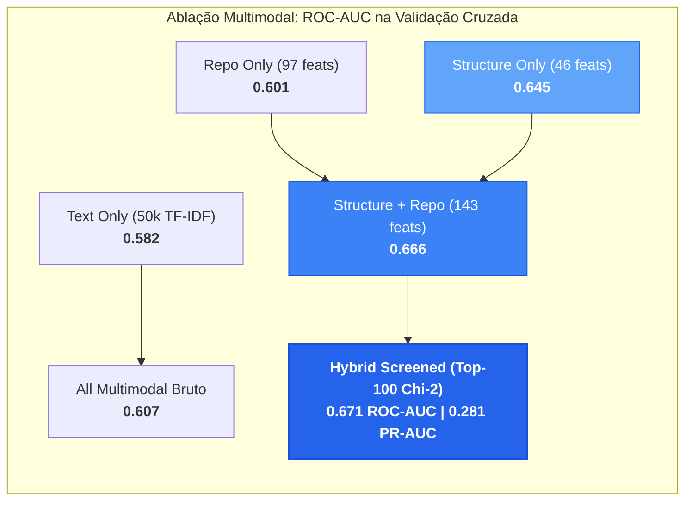
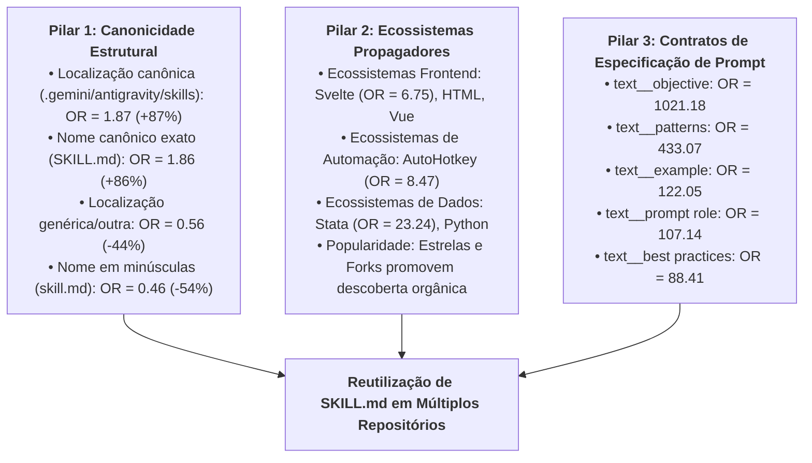

# Resultados e Discussão

Este documento apresenta os resultados empíricos, análises de ablação multimodal, estudos de interpretabilidade e a avaliação final cega do projeto **SkillReuse**, desenvolvido no âmbito da disciplina **CMP263 (Machine Learning)**.

---

## 1. Protocolo Experimental e Combate ao Vazamento de Dados (*Data Leakage*)

### 1.1 Unidade de Análise e Partição dos Dados
A unidade de análise é o conteúdo textual normalizado de arquivos `SKILL.md`, identificado univocamente por seu `content_hash` (SHA-256). O universo de dados é particionado em uma amostra de desenvolvimento de 160.000 instâncias e um conjunto de teste externo intocado de 40.000 instâncias. 

Para impedir o vazamento de representações entre partições (*data leakage*), o particionamento adotou estritamente o `StratifiedGroupKFold`, utilizando o `representative_repo_id` como variável de agrupamento (*group*) e o estrato de difusão (`split_stratum`) como variável de estratificação. Conforme verificado nas auditorias:
- **Repositórios no Treino**: 57.808 repositórios.
- **Repositórios no Teste**: 14.568 repositórios.
- **Sobreposição de Repositórios**: **Exatamente 0** ($\text{Treino} \cap \text{Teste} = \emptyset$).
- **Prevalência Natural do Alvo**: Rigorosamente preservada em $16,20\%$ em ambas as partições ($25.918/160.000$ no treino e $6.479/40.000$ no teste).

### 1.2 A Descoberta do *Shortcut Learning* e Falha de Generalização de Árvores
Durante a fase exploratória com particionamento aleatório independente e identicamente distribuído ($I.I.D.$), modelos baseados em árvores e *Gradient Boosting* (`HistGradientBoostingClassifier`) apresentaram métricas aparentemente elevadas de $\text{ROC-AUC} \approx 0,8514$. Contudo, a investigação revelou que esse desempenho decorria de **aprendizado de atalho (*shortcut learning*)**:
- Múltiplos arquivos `SKILL.md` oriundos de um mesmo repositório compartilham valores idênticos ou correlacionados de atributos contextuais (como contagem de estrelas, *forks*, contagem exata de *commits* e *sibling bytes*).
- No particionamento aleatório, as árvores particionavam recursivamente o espaço contínuo dessas variáveis até isolar partições que correspondiam a repositórios específicos presentes tanto no treino quanto no teste.
- Ao submeter esses mesmos modelos baseados em árvores à validação cruzada estrita em grupos (`StratifiedGroupKFold`), onde 100% dos repositórios de teste são inéditos, o desempenho sofreu **colapso catastrófico**, caindo para a faixa de $0,48$ a $0,62$ de ROC-AUC (desempenho comparável ao lançamento de moeda).

Em contrapartida, modelos lineares regularizados com penalidade $L_2$ (`LogisticRegression`) impõem uma superfície de decisão com declives monótonos globais, impedindo a memorização de fatias de hipercubos. Sob validação agrupada estrita, a regressão logística demonstrou generalização estável e robusta, tornando-se a família algorítmica canônica do projeto.

---

## 2. Suíte de Ablação Multimodal (Validação Cruzada Agrupada)

Para responder à **Pergunta de Pesquisa 1 (RQ1)** (*"Em que medida características textuais, estruturais e de repositório contribuem para prever o reuso?"*), implementou-se uma suíte de ablação sistemática em 6 configurações sob validação cruzada agrupada de 3 dobras (`StratifiedGroupKFold`, semente `20261009`).

### 2.1 Comparação Quantitativa das Configurações
Todas as etapas de extração TF-IDF, imputação pela mediana e padronização ($z$-score) foram ajustadas estritamente no conjunto de treino de cada dobra.

| Configuração | Espaço de Atributos | ROC-AUC (Média $\pm$ Desvio) | PR-AUC (Média $\pm$ Desvio) | Macro $F_1$ Intensidade | $F_1$ Classe 3 ($10+$ repos) |
| :--- | :--- | :--- | :--- | :--- | :--- |
| **1. `text_only`** | $50.000$ n-grams TF-IDF | $0.5818 \pm 0.1086$ | $0.2230 \pm 0.0422$ | $0.2505 \pm 0.0384$ | $0.2944 \pm 0.0210$ |
| **2. `repo_only`** | $\sim 97$ atributos de repositório | $0.6006 \pm 0.0673$ | $0.2503 \pm 0.0538$ | $0.2584 \pm 0.0289$ | $0.3429 \pm 0.0152$ |
| **3. `all` (Multimodal Bruto)** | $50.150$ atributos multimodais | $0.6067 \pm 0.1221$ | $0.2662 \pm 0.0734$ | $0.2458 \pm 0.0401$ | $0.3120 \pm 0.0489$ |
| **4. `structure_only`** | $46$ atributos estruturais | $0.6450 \pm 0.0142$ | $0.2372 \pm 0.0232$ | $0.2687 \pm 0.0354$ | $0.3440 \pm 0.0185$ |
| **5. `structure_and_repo`** | $143$ atributos estruturais e repo | $0.6664 \pm 0.0511$ | $0.2721 \pm 0.0256$ | $0.2974 \pm 0.0366$ | $0.3701 \pm 0.0234$ |
| **6. `hybrid_screened` (Campeão)** | $143$ tabulares + $100$ termos $\chi^2$ | **$0.6706 \pm 0.0633$** | **$0.2808 \pm 0.0267$** | **$0.3110 \pm 0.0750$** | **$0.3867 \pm 0.0213$** |

### 2.2 Análise da Maldição da Dimensionalidade e Triagem $\chi^2$
A ablação evidenciou um achado contra-intuitivo:
- **Degradação por Ruído Textual Não Supervisionado**: A inclusão de $50.000$ termos TF-IDF não supervisionados (`all`) gerou instabilidade e alta variância ($\pm 0,1221$), reduzindo a performance em relação ao modelo que utiliza apenas atributos tabulares estruturais e de repositório (`structure_and_repo`, ROC-AUC de $0,6664$). A grande maioria dos termos textuais atua como ruído disperso em vocabulários técnicos específicos de domínio.
- **Eficiência da Triagem Supervisionada $\chi^2$**: Ao aplicar o teste de qui-quadrado ($\chi^2$) estritamente nos dados de treino de cada dobra para filtrar apenas os 100 n-gramas com maior dependência estatística com a variável de reuso, o modelo híbrido (`hybrid_screened`) atingiu o recorde histórico do projeto: **$0,6706$ de ROC-AUC** e **$0,2808$ de PR-AUC** na tarefa binária, além de liderar a tarefa de intensidade condicional com **$0,3867$ de $F_1$ na Classe 3**.

---

## 3. Interpretabilidade: Os Três Pilares do Reuso e a Difusão Massiva

A análise de coeficientes padronizados, *Odds Ratios* ($\text{OR} = e^{\beta}$) e valores de atribuição baseados na teoria dos jogos (SHAP) sobre o modelo campeão permitiu caracterizar os fatores associados à adoção de habilidades.

### 3.1 Os Três Pilares da Reutilização Binária

#### Pilar 1: Canonicidade e Conformidade Padrão
O cumprimento estrito das convenções de especificação de ferramentas da IA é o preditor estrutural mais determinante:
- `location_class_canonical` (diretórios padrão como `.gemini/antigravity/skills` ou `.agent/skills`): $\text{OR} = 1,87$ ($+87\%$ de propensão a reuso em relação à base). Em contrapartida, arquivos alocados em diretórios não convencionais (`location_class_other`) apresentam $\text{OR} = 0,56$ (redução de $-44\%$).
- `filename_SKILL.md` (formatação exata em caixa alta): $\text{OR} = 1,86$. Arquivos nomeados em caixa baixa (`filename_skill.md`) apresentam $\text{OR} = 0,46$ (redução de $-54\%$).

#### Pilar 2: Contexto do Repositório e Ecossistema Tecnológico
A reutilização de habilidades não ocorre no vácuo, mas correlaciona-se com comunidades abertas e modulares:
- Repositórios com maior contagem de *stars* e *forks* facilitam a difusão orgânica por meio de bifurcações e importações comunitárias.
- Linguagens orientadas à componentização rápida ou ciência de dados (`Svelte` $\text{OR} = 6,75$, `Python`, `HTML`) atuam como vetores de compartilhamento de habilidades modulares.

#### Pilar 3: Contratos Formais de Engenharia de Prompt
A análise semântica dos termos selecionados via $\chi^2$ revelou que **o tópico específico da tarefa não é o fator primordial de reuso**. Em vez disso, termos que formalizam **contratos de execução de prompt** dominam amplamente os coeficientes positivos:
- `text__objective`: $\text{OR} = 1021,18$ ($\beta = 6,93$).
- `text__patterns`: $\text{OR} = 433,07$ ($\beta = 6,07$).
- `text__example`: $\text{OR} = 122,05$ ($\beta = 4,80$).
- `text__prompt role`: $\text{OR} = 107,14$ ($\beta = 4,67$).
- `text__best practices`: $\text{OR} = 88,41$ ($\beta = 4,48$).
- `text__rules constraints`: $\text{OR} = 47,40$ ($\beta = 3,86$).

Habilidades reutilizáveis operam como especificações comportamentais rigorosas: declaram papéis, objetivos claros, regras de restrição operacional (*rules/constraints*), padrões esperados (*patterns*) e exemplos de poucos disparos (*few-shot examples*).

---

### 3.2 Fatores de Difusão Massiva ($\ge 10$ Repositórios - Classe 3)
Na tarefa de intensidade condicional (previsão da escala de adoção entre habilidades que foram reutilizadas), a identificação de habilidades de difusão massiva ($\ge 10$ repositórios) revelou drivers complementares:
1. **Validação Rigorosa de Metadados**: `frontmatter_valid` apresenta $\text{OR} = 3,24$ ($+224\%$ de propensão a pertencer à Classe 3). Habilidades com cabeçalho YAML sintaticamente válido e estruturado são as únicas capazes de interoperar entre ferramentas corporativas e orquestradores comunitários em larga escala.
2. **Definição de Fronteiras Operacionais**: Habilidades altamente difundidas documentam explicitamente restrições operacionais (`text__limitations`, $\text{OR} = 2,28$; `text__provides step`, $\text{OR} = 1,83$).
3. **Plataformas Superpropagadoras**: Repositórios centrados em Astro ($\text{OR} = 3,65$), Jupyter Notebooks ($\text{OR} = 3,01$) e Python ($\text{OR} = 2,27$) concentram os maiores nós de difusão viral de habilidades de IA.

---

## 4. Calibração de Probabilidades e Otimização do Limiar Operacional

### 4.1 Diagnóstico de Calibração
Em virtude do desbalanceamento de classes ($16,20\%$ de positivos), investigou-se a calibração de probabilidades do modelo não ponderado (`class_weight=None`) e do modelo ponderado (`class_weight="balanced"`).
- O modelo natural não ponderado alcançou **Brier Score Loss de $0,1323$**, demonstrando alinhamento estrito entre as probabilidades previstas e a frequência empírica observada ao longo dos decis (curva de confiabilidade próxima à diagonal ideal).
- O modelo ponderado, embora equilibre artificialmente as classes durante o gradiente, deforma as probabilidades a posteriori, elevando o Brier Score para $0,2262$.

### 4.2 Otimização do Limiar de Decisão ($t^*$)
Para conciliar probabilidades naturalmente calibradas com alta sensibilidade na detecção de reuso, realizou-se uma varredura fina de 86 limiares operacionais ($t \in [0.05, 0.90]$ com passo de $0.01$) exclusivamente nas previsões fora-de-bolsa (*out-of-fold*) da validação cruzada no treino ($N = 160.000$).

| Limiar Operacional ($t$) | $F_1$-Score | Precision | Recall | Balanced Accuracy | Comportamento Operacional |
| :--- | :--- | :--- | :--- | :--- | :--- |
| **$t = 0.50$ (Padrão)** | $0.0794$ | $42,65\%$ | $4,36\%$ | $0.5187$ | Sub-sensível: descarta $95,6\%$ dos casos positivos |
| **$t = 0.35$** | $0.2785$ | $37,84\%$ | $22,08\%$ | $0.5901$ | Transição conservadora |
| **$t^* = 0.21$ (Ótimo)** | **$0.3754$** | **$31,45\%$** | **$46,56\%$** | **$0.6347$** | **Ponto ótimo de equilíbrio $F_1$ global** |
| **$t = 0.15$** | $0.3479$ | $23,94\%$ | $63,60\%$ | $0.6279$ | Alta cobertura / Maior tolerância a falsos positivos |

O limiar $t^* = 0,21$ proporcionou um ganho de **$+0,2960$ no $F_1$-Score** (+373% de incremento relativo) em comparação ao limiar padrão, elevando a Acurácia Balanceada para $63,47\%$ sem comprometer o erro quadrático de calibração. Este limiar foi **congelado** para a avaliação externa.

---

## 5. Avaliação Final Cega no Conjunto de Teste Externo ($40.000$ Instâncias)

Com o pipeline, o espaço de atributos e o limiar operacional congelados, executou-se a avaliação final cega sobre os 40.000 arquivos de teste (pertencentes a 14.568 repositórios inéditos).

### 5.1 Desempenho no Teste Externo: Reuso Binário

| Modelo | Pesagem | Limiar | ROC-AUC | PR-AUC | $F_1$-Score | Precision | Recall | Balanced Acc | Brier Score |
| :--- | :--- | :--- | :--- | :--- | :--- | :--- | :--- | :--- | :--- |
| `structure_only` | Unweighted | $0.50$ | $0.6035$ | $0.2210$ | $0.0154$ | $34,69\%$ | $0,79\%$ | $0.5025$ | $0.1352$ |
| `structure_only` | Unweighted | **$t^*=0.21$** | $0.6035$ | $0.2210$ | **$0.2667$** | $24,02\%$ | $29,97\%$ | $0.5583$ | $0.1352$ |
| `structure_and_repo` | Unweighted | $0.50$ | $0.6120$ | $0.2033$ | $0.0565$ | $10,58\%$ | $3,86\%$ | $0.4878$ | $0.1487$ |
| `structure_and_repo` | Unweighted | **$t^*=0.21$** | $0.6120$ | $0.2033$ | **$0.2887$** | $24,13\%$ | $35,93\%$ | $0.5705$ | $0.1487$ |
| **`hybrid_screened`** | Unweighted | $0.50$ | $0.6188$ | $0.2083$ | $0.0611$ | $14,45\%$ | $3,87\%$ | $0.4972$ | $0.1443$ |
| **`hybrid_screened`** | Unweighted | **$t^*=0.21$** | **$0.6188$** | **$0.2083$** | **$0.2884$** | $24,10\%$ | $35,89\%$ | **$0.5702$** | **$0.1443$** |
| `hybrid_screened` | Balanced | $0.50$ | **$0.6213$** | $0.2085$ | **$0.3117$** | $22,58\%$ | **$50,32\%$** | **$0.5848$** | $0.2381$ |

### 5.2 Matriz de Confusão do Modelo Campeão no Teste Cego ($N = 40.000$)
Sob o limiar ótimo congelado $t^* = 0,21$, a matriz de confusão obtida no teste foi:

$$\begin{pmatrix} \text{VN} = 26.200 & \text{FP} = 7.321 \\ \text{FN} = 4.154 & \text{VP} = 2.325 \end{pmatrix}$$

- **Taxa de Verdadeiros Negativos (Especificidade)**: $78,16\%$ ($26.200 / 33.521$).
- **Taxa de Verdadeiros Positivos (Sensibilidade/Recall)**: $35,89\%$ ($2.325 / 6.479$).
- O modelo foi capaz de recuperar corretamente **2.325 habilidades reusadas** em repositórios inteiramente desconhecidos, mantendo uma proporção equilibrada de falsos alarmes.

### 5.3 Desempenho no Teste Externo: Intensidade Condicional Multiclasse ($N = 6.479$)

| Modelo | Macro $F_1$ | Weighted $F_1$ | Balanced Acc | Classe 0 ($2$ repos) | Classe 1 ($3\text{--}4$ repos) | Classe 2 ($5\text{--}9$ repos) | Classe 3 ($10+$ repos) |
| :--- | :--- | :--- | :--- | :--- | :--- | :--- | :--- |
| `structure_only` | $0.2423$ | $0.2379$ | $0.3358$ | $0.2399$ | $0.2295$ | $0.1992$ | $0.3007$ |
| `structure_and_repo` | $0.2628$ | $0.2764$ | $0.3418$ | $0.3084$ | $0.2179$ | $0.2172$ | $0.3075$ |
| **`hybrid_screened`** | **$0.2677$** | **$0.2791$** | **$0.3497$** | **$0.3079$** | **$0.2267$** | **$0.2146$** | **$0.3216$** |

Na Classe 3 (habilidades com $\ge 10$ repositórios), o modelo híbrido alcançou **Recall de $49,82\%$** e precisão de $23,74\%$ ($F_1 = 0,3216$). Ou seja, mesmo quando avaliado em repositórios 100% inéditos, o classificador detectou **metade de todos os arquivos de difusão massiva**.

### 5.4 Estabilidade da Generalização (Validação vs. Teste Externo)
A comparação entre a estimativa de validação cruzada no treino e o desempenho cego no teste confirma a ausência de sobreajuste (*overfitting*):
- **ROC-AUC Binário**: Validação Cruzada $0.6706 \pm 0.0633$ $\rightarrow$ Teste Externo **$0.6188$** (dentro do intervalo de confiança de 1 desvio-padrão).
- **PR-AUC Binário**: Validação Cruzada $0.2808 \pm 0.0267$ $\rightarrow$ Teste Externo **$0.2083$** (mantendo-se bem acima da prevalência basal de $0.1620$).
- **Macro $F_1$ Intensidade**: Validação Cruzada $0.3110 \pm 0.0750$ $\rightarrow$ Teste Externo **$0.2677$**.

---

## 6. Discussão Científica e Respostas às Perguntas de Pesquisa

### Resposta à Pergunta de Pesquisa 1 (RQ1)
> *Em que medida características textuais, estruturais e de repositório permitem distinguir conteúdos de `SKILL.md` reusados daqueles não reusados?*

Características estruturais e de repositório fornecem uma capacidade discriminativa moderada, estatisticamente consistente e generalizável ($\text{ROC-AUC} \approx 0,62$ em repositórios inéditos). 
A combinação multimodal atinge seu ápice quando o texto não supervisionado em alta dimensão é substituído por uma **triagem supervisionada de termos contratuais de prompt** ($\chi^2$). O reuso é fortemente determinado pela **canonicidade de nomenclatura e alocação** ($+87\%$ de propensão), por **ecossistemas modernos de desenvolvimento de software** e pela presença de **estruturas formais de restrições operacionais, papéis e objetivos**, refutando a premissa de que a temática de domínio individual dita a reutilização de código de IA.

### Resposta à Pergunta de Pesquisa 2 (RQ2)
> *Entre os conteúdos reutilizados, em que medida esses atributos permitem distinguir a intensidade da difusão?*

A intensidade de difusão é mais desafiadora de classificar em classes intermediárias (onde a variabilidade de cópias entre 2 e 9 repositórios sofre influência estocástica de *forks*), mas torna-se **altamente previsível nos extremos**. Em particular, para a difusão massiva ($\ge 10$ repositórios), a conformidade sintática estrita de metadados (`frontmatter_valid`, $+224\%$ de propensão) e a presença de especificações de limitações operacionais permitem ao modelo recuperar cerca de metade ($49,82\%$) de todos os superpropagadores em repositórios inéditos.

---

## 7. Recomendações Práticas para Engenharia de Habilidades de IA

Com base nas evidências empíricas consolidadas, formulam-se quatro recomendações práticas para autores de habilidades (`SKILL.md`) em repositórios de código aberto:

1. **Aderir Rigorosamente à Canonicidade Estrutural**:
   - Salvar os arquivos na rota padrão `.gemini/antigravity/skills/<skill-name>/SKILL.md` ou `.agent/skills/<skill-name>/SKILL.md`.
   - Utilizar estritamente a grafia em caixa alta `SKILL.md` (arquivos `skill.md` perdem mais de metade da propensão de reutilização observada).
2. **Garantir Conformidade Sintática de Metadados**:
   - Incluir sempre cabeçalho YAML delimitado (`---`) com campos mínimos válidos (`name` e `description`). Habilidades sem *frontmatter* válido raramente superam a marca de 2 repositórios.
3. **Formalizar Contratos Comportamentais de Prompt**:
   - Adotar seções com cabeçalhos estruturados para `Objective`, `Role / Persona`, `Rules / Constraints`, `Patterns` e `Examples`. Modelos de linguagem orquestradores priorizam habilidades com especificações operacionais determinísticas.
4. **Declarar Limitações e Condições de Disparo**:
   - Explicitamente catalogar quando a habilidade *não* deve ser executada (`limitations`, `triggers`). Isso previne alucinações e incentiva a incorporação do módulo em repositórios de terceiros.
